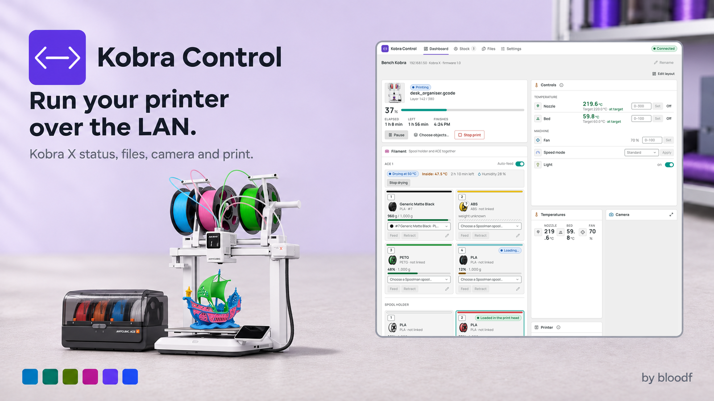
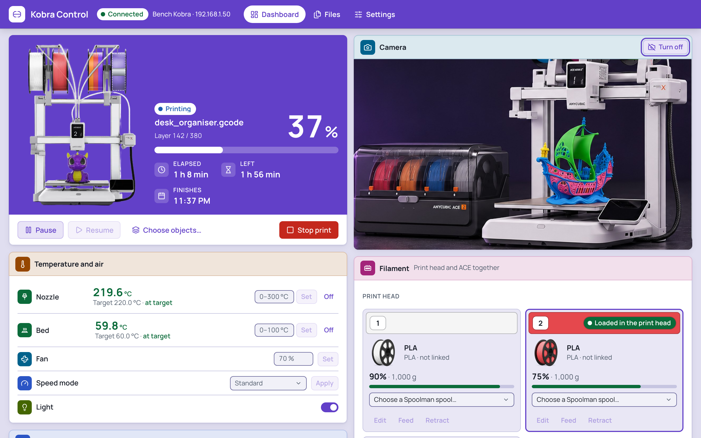
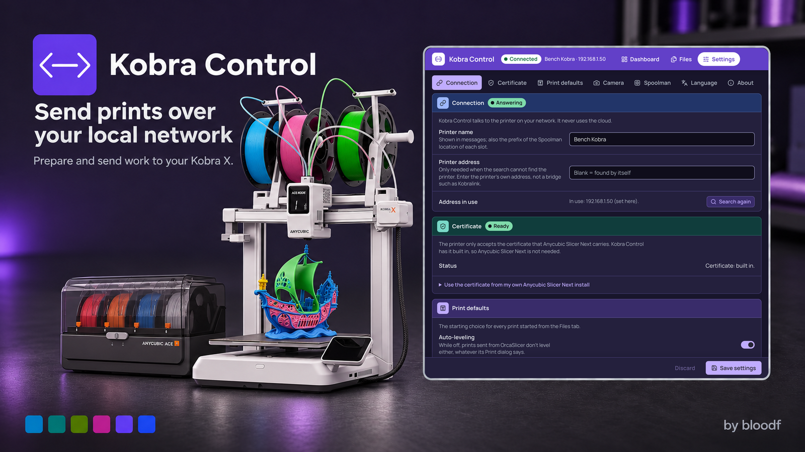
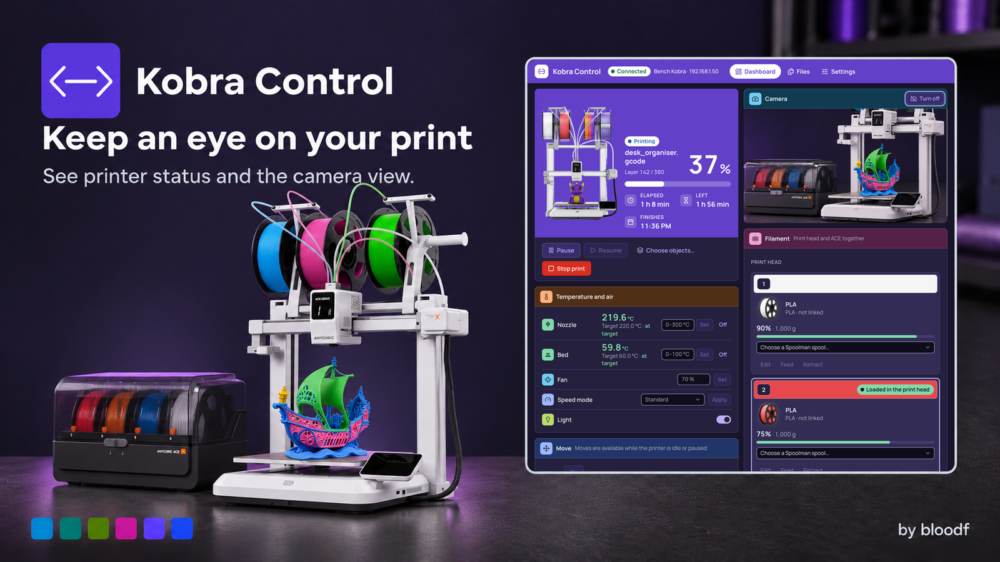
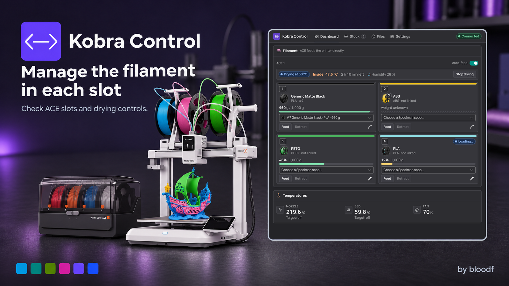
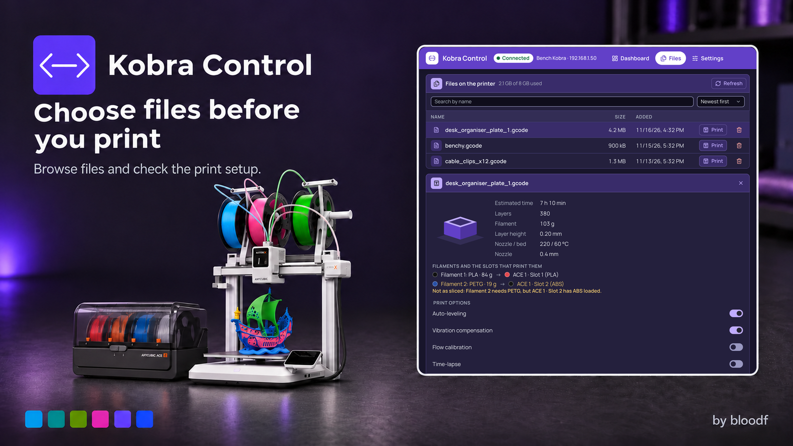
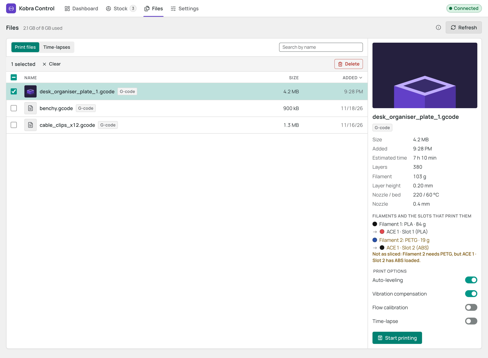

  <picture>
    <source media="(prefers-color-scheme: dark)" srcset="assets/readme/kobracontrol-hero-dark-en.png">
    
  </picture>

<h1 align="center">🟣 Kobra Control</h1>

<b>Run the Anycubic Kobra X from OrcaSlicer over your LAN.</b> An OrcaSlicer plugin · by bloodf

  
  
  
  

  <a href="#-install">Install</a> · <a href="#-features">Features</a> · <a href="#-how-to-use">How to use</a> · <a href="#-faq">FAQ</a> · <a href="README.pt-BR.md">Português</a>

## ✨ What it does

Kobra Control (`kobracontrol`) is an OrcaSlicer 2.5 plugin for the Anycubic Kobra X. It talks to the printer directly on your local network and registers an OrcaSlicer printer agent, so OrcaSlicer's own Print and Send dialogs and its Device tab work with the Kobra X. It also adds a **Kobra Control** tab with a dashboard, the camera, the ACE filament slots, the printer's files and Spoolman. It needs no cloud account and no extra Python packages.

  <picture>
    <source media="(prefers-color-scheme: dark)" srcset="assets/readme/kobracontrol-dashboard-dark-en.png">
    
  </picture>

## 📦 Install

Kobra Control is listed on Orca Cloud: open [its page](https://cloud.orcaslicer.com/p/59c786285255) and subscribe. Subscribing downloads it but does not turn it on. Then, in OrcaSlicer:

1. Open the plugin list. On macOS: **File > Plugins** in the menu bar at the top of the screen. On Windows and Linux: click the small **▾** arrow next to **File** at the top left of the OrcaSlicer window, then **Plugins** (it is not inside the File menu there).
2. The first column of the list is headed **Activate**. Tick the box in that column on the **Kobra Control** row.
3. Allow what OrcaSlicer asks for. The **Kobra Control** tab appears next to Prepare, Preview and Device.

To turn it off again, untick the same box. To remove it, select **Kobra Control** in the same list and uninstall it there, or unsubscribe on Orca Cloud.

From a file:

1. Download `kobracontrol_any.whl` from the [latest release](https://github.com/bloodf/kobracontrol/releases/latest).
2. In OrcaSlicer open the plugin list (macOS: **File > Plugins**; Windows and Linux: the **▾** arrow next to **File** > **Plugins**), choose **Install local plugin** and pick the wheel.
3. Tick its box in the **Activate** column and allow what OrcaSlicer asks for. The **Kobra Control** tab appears next to Prepare, Preview and Device.

| Requirement | Detail |
|---|---|
| OrcaSlicer | 2.5.0 or newer, the stock build. No patched build is needed. |
| Printer | An Anycubic Kobra X on the same network, with LAN mode enabled. Checked on firmware 2.0.2.8. |
| `ffmpeg` | Optional. The Kobra Control tab plays the camera with its built-in player; `ffmpeg` is only needed when that player can't (an RTSP stream, or a system without H.264 video support, possible on Linux). The Device tab camera works without it. |
| Anycubic Slicer Next | Not required. The client certificate the printer asks for is bundled. |
| Spoolman | Optional, for spool tracking. |

### Verified on the printer

Run on a real Kobra X through the plugin's service layer, outside OrcaSlicer. The dates come from the [changelog](CHANGELOG.md) and [docs/protocol.md](docs/protocol.md).

| What was checked | Firmware | Date |
|---|---|---|
| Connect, credentials, status, ACE slots, file list, details, upload and delete, light, camera stream | 2.0.2.8 | 2026-11-14 |
| Homing, jogging and heating while idle | 2.0.2.8 | 2026-11-14 |
| A print from a `.3mf` with a slot mapping, finish detection and the job's filament use | 2.0.2.8 | 2026-11-14 |
| How the printer answers the network search (SSDP) | 2.0.2.8 | 2026-11-15 |
| Listing the time-lapse videos | 2.0.2.8 | 2026-11-16 |
| Deleting a time-lapse video | 2.0.2.8 | 2026-11-16 |

Not tried on the printer yet: pause, resume, stop, filament feed and retract, drying, slot edit, skip objects, speed mode, Spoolman booking, flow calibration and time-lapse at print start, the Printer panel and Print Assist, and the G-code checks. Nothing has been tested inside OrcaSlicer itself (Device tab, Print dialog, permission dialogs).

Kobra Control is an independent project. It is not made or supported by Anycubic.

## 🧰 Features

<table>
  <tr>
    <td width="50%" valign="top">
      
      
<b>Send prints over your local network</b> Print and Send work from OrcaSlicer's own dialogs. The tab finds the printer by itself and the client certificate is built in.

    </td>
    <td width="50%" valign="top">
      
      
<b>Keep an eye on your print</b> Progress, layer, time left and the clock time the print should finish, next to temperatures, fan, speed, light and the camera.

    </td>
  </tr>
  <tr>
    <td width="50%" valign="top">
      
      
<b>Manage the filament in each slot</b> Every print head and ACE slot shows its colour and material, with feed, retract, auto-feed, drying and the Spoolman spool linked to it.

    </td>
    <td width="50%" valign="top">
      
      
<b>Choose files before you print</b> Browse the printer's files and see time, layers, filament and which ACE slot prints each colour before you press <b>Start printing</b>.

    </td>
  </tr>
</table>

| Feature | What you get |
|---|---|
| Printer agent | The agent id is `kobracontrol`. After OrcaSlicer's Print dialog, Kobra Control's own print setup window opens, so there are two dialogs: OrcaSlicer has no hook to replace its own. The window starts from OrcaSlicer's choice and shows each filament's slot (same material only, with its Spoolman spool) and the print options, then sends exactly that. Send uses OrcaSlicer's dialog only. Before sending, it reads the sliced G-code and warns when the settings block or a PNG preview picture is missing. |
| Device tab | Status, temperatures, pause, resume, stop, light, fan, speed and the camera in OrcaSlicer's own Device tab. ACE slots show there as filament slots, with sync and slot mapping in the print dialog. |
| Dashboard | The print with its progress and actions, the filament slots, one Controls module (temperatures, fan, speed mode, light), the camera, moves and homing, a Printer panel and a Console (what the plugin sent and what came back). |
| Your dashboard | **Edit layout** on the Dashboard: drag widgets to move them, drag their edges or corners to resize them, remove them, add them from the list (also a Temperatures readout and a Files shortcut), and set the ones that have settings (camera shape, console lines, which readings show). Keep several named layouts and switch between them. Layouts are saved in Kobra Control's settings. |
| Stock | Spooler's spool stock in its own tab: choose a slot on the left, then **Link** on a spool's row. |
| Printer panel | Firmware, network address, print counters and the **Print Assist** switches. The printer's name and **Rename** are in the page header. |
| Files | A file browser: search, sort by any column, select one or several files and **Delete** them in one go (the checkboxes, Shift and Ctrl/Cmd, or the keyboard). The Kobra X has no folders and no way to move a file, so there is no folder tree and no **Move to**. Select one file for its picture, details and print options. The print panel warns when a slot holds a different material than the file was sliced with, when a filament has no loaded slot, and when the file was sliced for another printer. The confirmation repeats the warning. |
| Time-lapses | The printer's time-lapse videos, as a second list in the Files tab (**Print files** | **Time-lapses** over the table), with print, date, length and size, and **Delete** for one or several. The printer offers no way to download a video over the local network yet. |
| Spoolman | Link a Spoolman spool to a slot. Finished prints book their filament use there when the option is on. |
| Works with Spooler | [Spooler](https://github.com/bloodf/spooler) turns your Spoolman filaments into OrcaSlicer filament profiles. With it installed, the Stock tab shows Spooler's stock. Kobra Control also works alongside [Print Calculator](https://github.com/bloodf/orca_print_calculator). |
| Settings | Requirements (ffmpeg, Anycubic Slicer Next, OrcaSlicer's printer agents and Spoolman: what is found, what needs it, how to install it), connection (with the printer's certificate fingerprint), certificate, print defaults, `ffmpeg` path, Spoolman and language. If the printer presents a different TLS certificate than last time, every tab shows a warning. |
| Plugins > Run | **Check Kobra X connection** reports the certificate, credentials, MQTT and firmware version. **Find Anycubic certificate** looks for the client certificate and reports the result. |

Not supported: Anycubic Cloud and access from outside your local network, a G-code console (the printer's LAN protocol has none), and other Kobra models.

## 🛠️ How to use

1. Turn on LAN mode on the Kobra X and put the printer and the computer on the same network.
2. Open the **Kobra Control** tab. It looks for the printer by itself. The first time, OrcaSlicer asks once whether kobracontrol may connect to that address. Allow it.
3. Use the **Dashboard** to follow the print, set temperatures, turn the camera on with **Turn on**, and feed, retract or dry filament.
4. To print a file stored on the printer, open **Files**, press **Print** on the file, check the panel and press **Start printing**.
5. To send prints from OrcaSlicer itself, open **Preferences > Developer > Experimental Features**, tick **Use printer agents instead of print hosts** and restart OrcaSlicer. Then, in a copy of your Kobra X printer preset, set **Printer Agent** to `kobracontrol` and the address to the printer's IP.
6. Run **Plugins > Check Kobra X connection**. Then, in OrcaSlicer's print dialog, sync the ACE slots, map each filament to a slot and send the print.

  <picture>
    <source media="(prefers-color-scheme: dark)" srcset="assets/readme/kobracontrol-files-dark-en.png">
    
  </picture>

Steps 5 and 6 are optional. Without them the tab works on its own, for example next to Kobralink or another Moonraker bridge that your printer preset already uses, and OrcaSlicer's Print, Send and Device tab keep using the preset's own agent.

The tab looks for the printer in this order: the address in **Settings** if you set one, the address it found before for the selected printer preset, the preset's own address if a Kobra X answers there, then a search of the local network (SSDP, the way Anycubic Slicer Next finds printers). A printer the search finds is used only after you choose it.

After a print starts, the printer can spend many minutes in preparation (heating, levelling, and cycling through the ACE slots) before the first layer. In one test that took about 11 minutes for a 5 minute print. The printer is not hung; the job is reported as printing meanwhile.

Full steps and a troubleshooting table are in [docs/setup.md](docs/setup.md).

## 🔒 Privacy and safety

### What the plugin can access

| OrcaSlicer permission | What it is used for |
|---|---|
| Network: the printer's address and the multicast group 239.255.255.250 | HTTP on port 18910 (credentials, G-code upload), MQTT over TLS on port 9883 (status and commands) and the network search. OrcaSlicer asks once for a printer found later. |
| Network: your Spoolman address, only if you set one | Spool links and filament use. |
| Read: OrcaSlicer's temporary folder | The sliced file that Print and Send hand over. It is read, checked and uploaded as it is, never changed. |
| Read: Anycubic Slicer Next's files, only when you press **Find certificate** | Its client certificate. OrcaSlicer asks first. |
| Run: `ffmpeg`, only for the camera in the tab | Turning the printer's stream into pictures. OrcaSlicer shows the command and asks. |
| Threads | Network work off OrcaSlicer's main thread. |

Print files and commands go to the printer, spool links and filament use go to Spoolman, and nothing goes anywhere else. There is no telemetry and no analytics. The plugin writes files only in its own storage folder (settings, the print ledger, the printers it found) and reads Spooler's stock list when Spooler is installed.

### Network and certificate

Kobra Control connects only to the Kobra X and to your Spoolman server, if you set one. The printer is reached over HTTP on port 18910 and MQTT over mutual TLS on port 9883, at the address you set or one the plugin found on your local network and confirmed as a Kobra X in LAN mode. The network search sends SSDP queries to the local multicast group 239.255.255.250 only. There is no cloud service.

Use it on a network you trust. The printer hands out its MQTT credentials to anyone on the network, and its TLS certificate is self-signed and not verified, so the connection is protected against passive reading only.

The printer accepts only the TLS client certificate that Anycubic Slicer Next carries. That certificate is a shared client identity, the same in every copy of Anycubic Slicer Next, not a per-user secret, and the plugin bundles it. Neither that certificate's key nor the MQTT credentials are ever sent to the page or written to logs.

In the tab, stopping a print, heating, homing, turning the motors off, skipping objects, feeding or retracting filament, starting a drying cycle, printing a stored file and deleting files all ask first. Details are in [SECURITY.md](SECURITY.md).

## ❓ FAQ

Do I need Anycubic Slicer Next installed?

No. The client certificate is bundled, so there is no certificate step. If a future firmware stops accepting the bundled copy, **Find certificate** (in **Settings**, under the certificate's advanced option) replaces it with the one from your own Anycubic Slicer Next install.

The print started but nothing moves for minutes. Is it stuck?

No. The printer heats, levels and cycles through the ACE slots before the first layer. In one test that took about 11 minutes for a 5 minute print.

Can I keep using Kobralink or another Moonraker bridge?

Yes. Leave your printer preset as it is. The Kobra Control tab finds the printer and works on its own, and OrcaSlicer's Print, Send and Device tab keep going through the bridge. When the preset's address is a bridge and not the printer, the tab says so in one line.

Why does OrcaSlicer ask for permission to run ffmpeg?

Only when the built-in player can't play the camera does the Kobra Control tab use `ffmpeg` to turn the printer's stream into pictures. When it starts, OrcaSlicer shows the full command with the printer's stream address and asks. It asks again when that address changes, which happens when the printer restarts. The Device tab camera does not need `ffmpeg`.

Nothing connects, or "No Kobra X answered the network search".

Check that LAN mode is on at the printer and that the printer and the computer are on the same network. If your network blocks multicast, type the printer's IP under **Settings > Printer address**.

"Something answers at … but it is not a Kobra X in LAN mode".

The address belongs to another device, often a bridge such as Kobralink, or LAN mode is off. Leave **Settings > Printer address** blank so the tab searches, or type the printer's own IP there.

The printer preset has no kobracontrol Printer Agent.

**Use printer agents instead of print hosts** is off. Turn it on under **Preferences > Developer > Experimental Features** and restart OrcaSlicer.

"Could not connect to OctoPrint" when I print to the Kobra X.

The Kobra X has no OctoPrint server, so a physical printer of the type OctoPrint pointed at the printer's own address can't reach it. Two ways out:

- **Print through Kobra Control's printer agent** (recommended). Remove that physical printer, tick **Use printer agents instead of print hosts** under **Preferences > Developer > Experimental Features**, restart OrcaSlicer, then set **Printer Agent** to `kobracontrol` in a copy of your Kobra X printer preset. The printer's address is optional there: Kobra Control finds the printer on the network.
- **Keep the OctoPrint physical printer, but point it at Kobra Control.** In the Kobra Control tab open **Settings > Upload bridge**, turn it on, and copy the two values it shows (each has a **Copy** button) into the physical printer: **Hostname, IP or URL** `127.0.0.1:8765` (not the printer's IP) and **API Key / Password** the bridge's key. Press **Test**. Upload and Print then waits in the Kobra Control tab for you to press **Start print**.

The Dashboard says so, with a button to the upload bridge, when the selected Kobra X preset sends to OctoPrint.

The Stock tab: does it need Spooler?

No. With Spooler running and sharing its stock list, the tab shows Spooler's list. Without it, or with a Spooler version that shares its list only with U1 Control, the tab lists the spools straight from the Spoolman set in **Settings** (or the one Spooler uses), and says so.

Can a spool use my own tuned filament preset?

Yes, through OrcaSlicer's sync from AMS. In Spoolman add a Text extra field with the key `orca_filament_preset` to spools or filaments (**Settings > Extra fields**) and type your preset's name in it; the spool's value wins over the filament's. It must be one of your own presets and compatible with the printer. Sync can only load a standalone preset (one that inherits nothing, such as a detached copy); a preset made with **Save as** inherits its parent and sync would load the parent, so the slot keeps the usual preset. A name that isn't found shows a notice once. Details in [docs/setup.md](docs/setup.md#8-use-your-own-filament-preset-for-a-spool-optional).

Can I download the time-lapse videos?

Not yet. The printer has no known way to hand a video over the local network, so the tab lists and deletes them only.

## 🌍 Languages

English, Brazilian Portuguese, Spanish, German, Simplified Chinese and Polish. The tab follows OrcaSlicer's language, and **Settings > Language** changes it.

## 🧩 More plugins by bloodf

| | Plugin | What it does | |
|:-:|---|---|---|
|  | 🧩 [Organizer](https://github.com/bloodf/orca_organizer) | Arrange parts by their real outline and fill a plate with more copies. | [Install](https://cloud.orcaslicer.com/p/5bf381fd42d4) |
|  | 🧲 [Embedder](https://github.com/bloodf/embedder) | Magnet and NFC pockets, with the pause at the right layer. | [Install](https://cloud.orcaslicer.com/p/58222d4f9e52) |
|  | 💰 [Print Calculator](https://github.com/bloodf/orca_print_calculator) | Price every plate: filament, energy, labour, fees and margin. | [Install](https://cloud.orcaslicer.com/p/521c07cf6de2) |
|  | 🧵 [Spooler](https://github.com/bloodf/spooler) | Your Spoolman stock inside OrcaSlicer, with what is left on each spool. | [Install](https://cloud.orcaslicer.com/p/50c35dcbd6f3) |
|  | 🟣 **Kobra Control** · you are here | Run the Anycubic Kobra X from OrcaSlicer over your LAN. | |
|  | 🔵 [U1 Control](https://github.com/bloodf/u1control) | Run the Snapmaker U1 from OrcaSlicer: toolheads, camera, files. | [Install](https://cloud.orcaslicer.com/p/55b8c347d443) |

Each plugin works on its own; installed together they share data where it helps.

## 🤝 Contributing

Bug reports, logs and pull requests are welcome. Start with [CONTRIBUTING.md](CONTRIBUTING.md). The developer documentation is in [docs/](docs/): [setup](docs/setup.md), [architecture](docs/architecture.md), [protocol](docs/protocol.md), [releasing](docs/release.md) and the [Orca Cloud description](docs/orca-cloud-description.md). See also the [changelog](CHANGELOG.md), the [security notes](SECURITY.md) and [NOTICE.md](NOTICE.md) for credits to the projects the protocol code is ported from.

## 📄 License

GPL-3.0-only. See [LICENSE](LICENSE).

Printer photo: Anycubic product image (see [NOTICE.md](NOTICE.md)).

by bloodf

