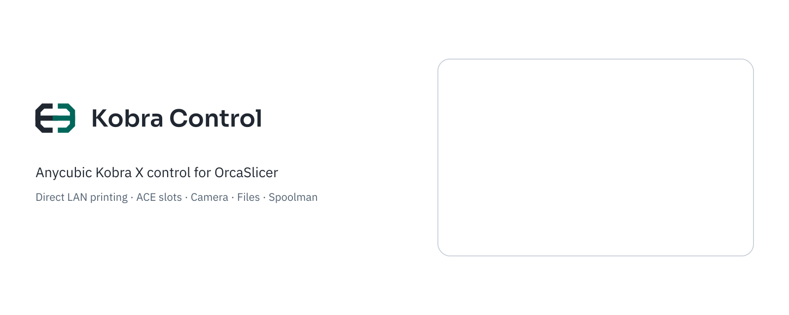
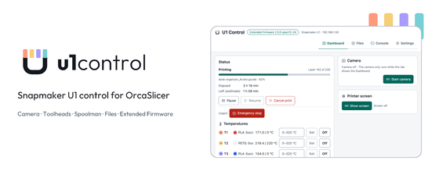
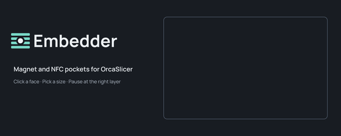
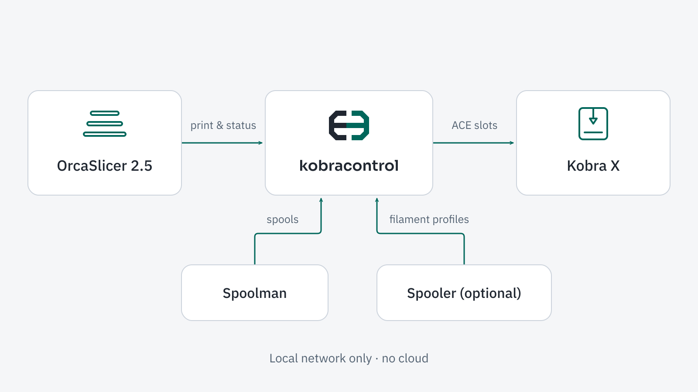

<p align="center">
  <picture>
    <source media="(prefers-color-scheme: dark)" srcset="assets/readme/kobracontrol-hero-dark.png">
    
  </picture>
</p>

<p align="center">
  <a href="https://github.com/bloodf/kobracontrol/actions/workflows/ci.yml"></a>
  <a href="https://github.com/bloodf/kobracontrol/releases/latest"></a>
  <a href="LICENSE"></a>
  
</p>

# kobracontrol

kobracontrol is an OrcaSlicer 2.5 plugin for the Anycubic Kobra X. It talks to the printer directly
on your local network and registers an OrcaSlicer printer agent, so OrcaSlicer's own Print and Send
dialogs and its Device tab work with the Kobra X. It also adds a Kobra Control tab with a dashboard,
camera, ACE card, file list and Spoolman.

Everything stays on your local network. The plugin needs no extra Python packages and no cloud.

<p align="center">
  
  
  
  
  
  
  
</p>

> **Status: in development.** The plugin's service layer was run against a real Kobra X
> (firmware 2.0.2.8) outside OrcaSlicer: connect, status, ACE, files, light, camera stream, homing,
> jogging, heating and a print from a `.3mf`. Pause, resume, stop, filament feed and retract,
> drying, slot edit, skip objects, speed mode and Spoolman booking have not been tried on the
> printer, and nothing has been tested inside OrcaSlicer itself.

After a print starts, the printer can spend many minutes in preparation (heating, levelling, and
cycling through the ACE slots) before the first layer. In one test that took about 11 minutes for a
5 minute print. The printer is not hung; the job is reported as printing meanwhile.

kobracontrol is an independent project. It is not made or supported by Anycubic.

<!-- related-plugins:start -->
## Explore the other plugins

Complete your OrcaSlicer workflow: arrange, price, manage filament and print. Each plugin works on its own; installed together they share data where it helps.

<table>
  <tr>
    <td width="33%" valign="top">
      <a href="https://cloud.orcaslicer.com/p/5bf381fd42d4"></a>
      <h3><a href="https://cloud.orcaslicer.com/p/5bf381fd42d4">Organizer</a></h3>
      <a href="https://cloud.orcaslicer.com/p/5bf381fd42d4"></a>
      <p>Arrange objects by their real outline and fill a build plate with more copies.</p>
      <p><a href="https://cloud.orcaslicer.com/p/5bf381fd42d4">Install from Orca Cloud →</a><br><a href="https://github.com/bloodf/orca_organizer">Source on GitHub →</a></p>
    </td>
    <td width="33%" valign="top">
      <a href="https://cloud.orcaslicer.com/p/521c07cf6de2"></a>
      <h3><a href="https://cloud.orcaslicer.com/p/521c07cf6de2">Orca Print Calculator</a></h3>
      <a href="https://cloud.orcaslicer.com/p/521c07cf6de2"></a>
      <p>Price every build plate: Spoolman filament cost, energy, labor, fees and a suggested selling price.</p>
      <p><a href="https://cloud.orcaslicer.com/p/521c07cf6de2">Install from Orca Cloud →</a><br><a href="https://github.com/bloodf/orca_print_calculator">Source on GitHub →</a></p>
    </td>
    <td width="33%" valign="top">
      <a href="https://cloud.orcaslicer.com/p/50c35dcbd6f3"></a>
      <h3><a href="https://cloud.orcaslicer.com/p/50c35dcbd6f3">Spooler</a></h3>
      <a href="https://cloud.orcaslicer.com/p/50c35dcbd6f3"></a>
      <p>Your Spoolman spools and filament presets in OrcaSlicer, with what is left on each spool.</p>
      <p><a href="https://cloud.orcaslicer.com/p/50c35dcbd6f3">Install from Orca Cloud →</a><br><a href="https://github.com/bloodf/spooler">Source on GitHub →</a></p>
    </td>
  </tr>
  <tr>
    <td width="33%" valign="top">
      <a href="https://cloud.orcaslicer.com/p/55b8c347d443"></a>
      <h3><a href="https://cloud.orcaslicer.com/p/55b8c347d443">U1 Control</a></h3>
      <a href="https://cloud.orcaslicer.com/p/55b8c347d443"></a>
      <p>The Snapmaker U1 in OrcaSlicer: print setup, camera, toolheads, RFID, Spoolman and a file manager.</p>
      <p><a href="https://cloud.orcaslicer.com/p/55b8c347d443">Install from Orca Cloud →</a><br><a href="https://github.com/bloodf/u1control">Source on GitHub →</a></p>
    </td>
    <td width="33%" valign="top">
      <a href="https://cloud.orcaslicer.com/p/58222d4f9e52"></a>
      <h3><a href="https://cloud.orcaslicer.com/p/58222d4f9e52">Embedder</a></h3>
      <a href="https://cloud.orcaslicer.com/p/58222d4f9e52"></a>
      <p>Cut magnet and NFC sticker pockets into a part, with a pause at the right layer to drop each insert in.</p>
      <p><a href="https://cloud.orcaslicer.com/p/58222d4f9e52">Install from Orca Cloud →</a><br><a href="https://github.com/bloodf/embedder">Source on GitHub →</a></p>
    </td>
    <td width="33%" valign="top"></td>
  </tr>
</table>

Illustrative project artwork. [Credits and licenses](docs/related-plugins/README.md).
<!-- related-plugins:end -->

## How it works

<picture>
  <source media="(prefers-color-scheme: dark)" srcset="assets/diagrams/how-it-works-dark.png">
  
</picture>

kobracontrol connects to the printer over HTTP on port 18910 and MQTT over mutual TLS on port 9883.
The printer must have LAN mode enabled. The printer only accepts the TLS client certificate that
Anycubic Slicer Next carries. This is a shared client identity, the same in every copy of Anycubic
Slicer Next, not a per-user secret; kobracontrol bundles it so the plugin connects out of the box.
If a future firmware stops accepting the bundled copy, **Find certificate** (Settings, under the
certificate's advanced option) replaces it with the one from your own Anycubic Slicer Next install.

The tab finds the printer by itself: the address in Settings if you set one, else the address it found
before for the selected printer preset, else the preset's own address if a Kobra X answers there, else
a search of the local network (SSDP, the way Anycubic Slicer Next finds printers). The protocol is
described in [docs/protocol.md](docs/protocol.md).

## Features

### Printer agent

The agent has the id `kobracontrol`. With it, OrcaSlicer's own dialogs work with the Kobra X:

- Print and Send, with the filament-to-slot mapping you pick in Orca's print dialog, auto-leveling, flow
  calibration and time-lapse from that dialog, and vibration compensation from the plugin's settings.
- Device tab: status, temperatures, pause, resume, stop, light, fan and speed.
- ACE slots shown as filament slots, with sync and slot mapping in Orca's print dialog.
- Device tab camera.

### Kobra Control tab

- **Dashboard:** status and controls (with the clock time a running print should finish), camera, an ACE card (slots, feed, retract, auto-feed and
  drying), a Printer panel (name and Rename, firmware, network address, print counters, Print Assist switches),
  Spoolman and Spooler stock.
- **Files:** the printer's files, with search and sorting (newest, oldest, name, size). Before you print
  one, the print panel shows its estimated time, layers, filament, layer height and temperatures, and
  which ACE slot will print each of its filaments. It warns when a slot holds a different material than
  the file was sliced with, when a filament has no loaded slot, and when the file was sliced for another
  printer; the confirmation repeats the warning.
- **Settings:** connection (with the printer's certificate fingerprint), certificate, ffmpeg path, Spoolman
  and Spooler. If the printer presents a different TLS certificate than last time, every tab shows a
  warning; see [SECURITY.md](SECURITY.md).

The tab's camera needs `ffmpeg` installed. The Device tab camera does not. When the tab's camera
starts, OrcaSlicer asks for permission to run the `ffmpeg` command, and shows the full command with
the printer's stream address. It asks again when that address changes, which happens when the
printer restarts.

### Plugins > Run

- **Check Kobra X connection:** certificate, credentials, MQTT and firmware version.
- **Find Anycubic certificate:** finds the client certificate and reports the result.

### Works with Spooler

<picture>
  <source media="(prefers-color-scheme: dark)" srcset="assets/diagrams/kobracontrol-works-with-spooler-dark.png">
  
</picture>

[Spooler](https://github.com/bloodf/spooler) turns your Spoolman filaments into OrcaSlicer filament
profiles. With Spooler installed, kobracontrol shows Spooler's stock on the Dashboard. The plugin
also works alongside [Orca Print Calculator](https://github.com/bloodf/orca_print_calculator). Each
plugin works on its own.

### Not supported

- Anycubic Cloud and access from outside your local network.
- A G-code console. The printer's LAN protocol has none.
- Other Kobra models.

## Requirements

- OrcaSlicer 2.5.0 or newer.
- An Anycubic Kobra X on the same network, with LAN mode enabled.
- `ffmpeg`, only for the tab's camera.

Anycubic Slicer Next is not required: the client certificate is bundled. Install it only if you need
to replace the bundled certificate with your own copy.

## Install

Download `kobracontrol_any.whl` from the [latest release](https://github.com/bloodf/kobracontrol/releases/latest), or build it:

```sh
python3 scripts/build.py     # writes dist/kobracontrol_any.whl
```

In OrcaSlicer use **File > Plugins > Install local plugin**, pick the wheel, then tick **Activate**.
The **Kobra Control** tab appears next to Prepare, Preview and Device.

## Setup

Full steps are in [docs/setup.md](docs/setup.md). There are two ways to run it:

- **Kobra Control tab only**, for example next to Kobralink or another Moonraker bridge that your
  printer preset already uses: nothing to set up. The tab finds the printer on the network and works on
  its own; OrcaSlicer's Print, Send and Device tab keep using the preset's own agent.
- **As OrcaSlicer's printer agent** as well, so Print, Send and the Device tab go through kobracontrol:
  tick **Preferences > Developer > Experimental Features > Use printer agents**, then set the printer
  preset's **Printer Agent** to `kobracontrol` and its address to the printer's IP.

The certificate is bundled, so there is no certificate step.

## Privacy and security

kobracontrol connects only to the Kobra X (the address you set, or one it found on your local
network and confirmed as a Kobra X in LAN mode) and to your Spoolman server. It has no cloud service.
The network search sends SSDP queries to the local multicast group 239.255.255.250 only. Use it on a network you trust: the printer hands out its MQTT
credentials to anyone on the network, and its TLS certificate is self-signed and not verified, so
the connection is protected against passive reading only. The client certificate copy and the MQTT
credentials are never sent to the page or written to logs. See [SECURITY.md](SECURITY.md).

## Documentation

- [Setup](docs/setup.md)
- [Protocol](docs/protocol.md)
- [Brand image prompt](docs/brand-images-prompt.md)
- [Notice](NOTICE.md), [Contributing](CONTRIBUTING.md), [Changelog](CHANGELOG.md) and [Security](SECURITY.md)

## Credits

The protocol code is ported from two GPL-3.0 projects:
[KX-Bridge](https://gitea.it-drui.de/viewit/KX-Bridge-Release) (viewit and contributors) and
[Kobralink](https://github.com/NatHacks/Kobralink) (NatHacks). See [NOTICE.md](NOTICE.md).
kobracontrol is independent and not made or supported by Anycubic.

License: [GPL-3.0-only](LICENSE).
