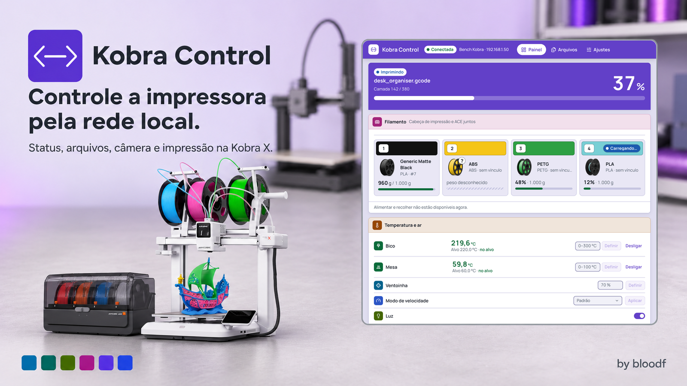
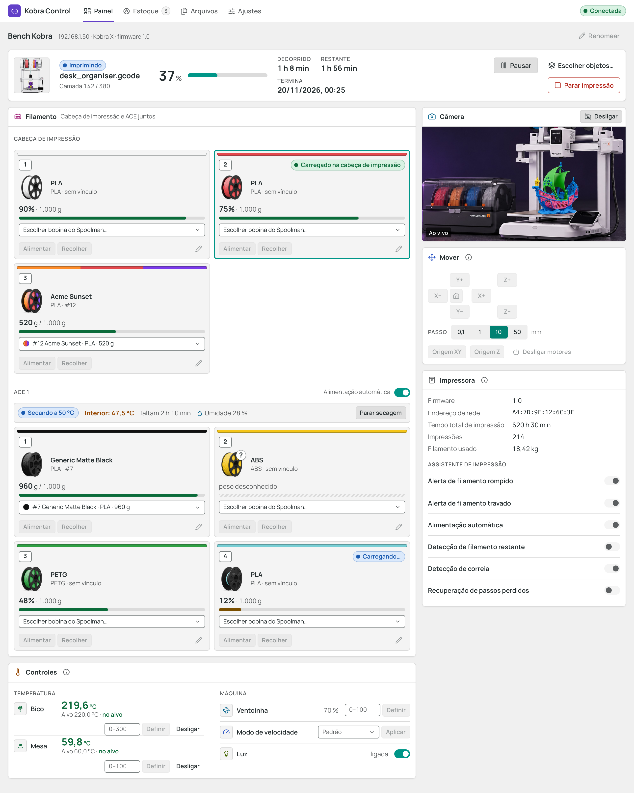
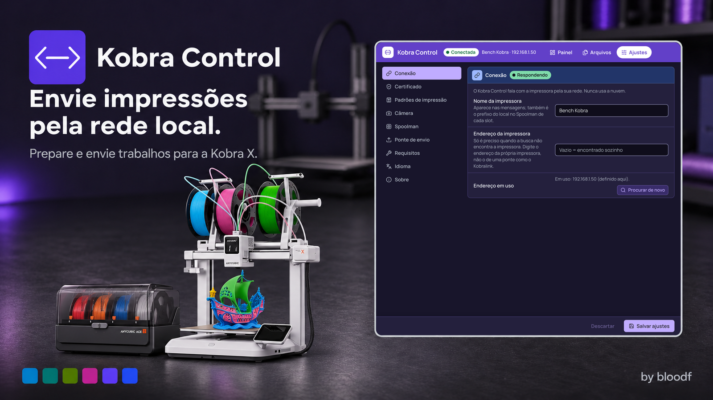
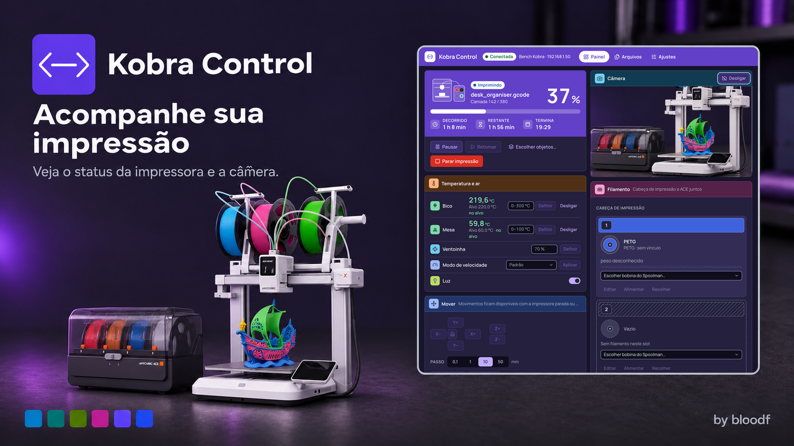
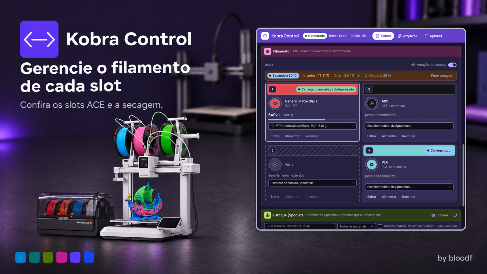
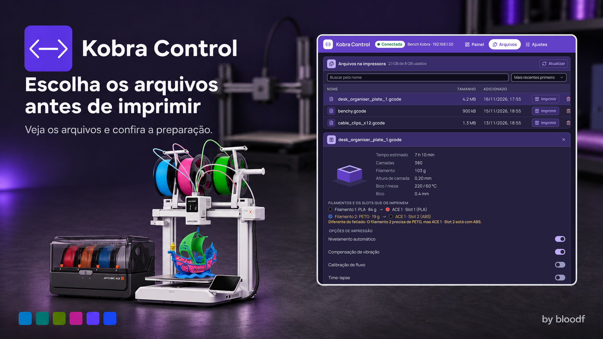
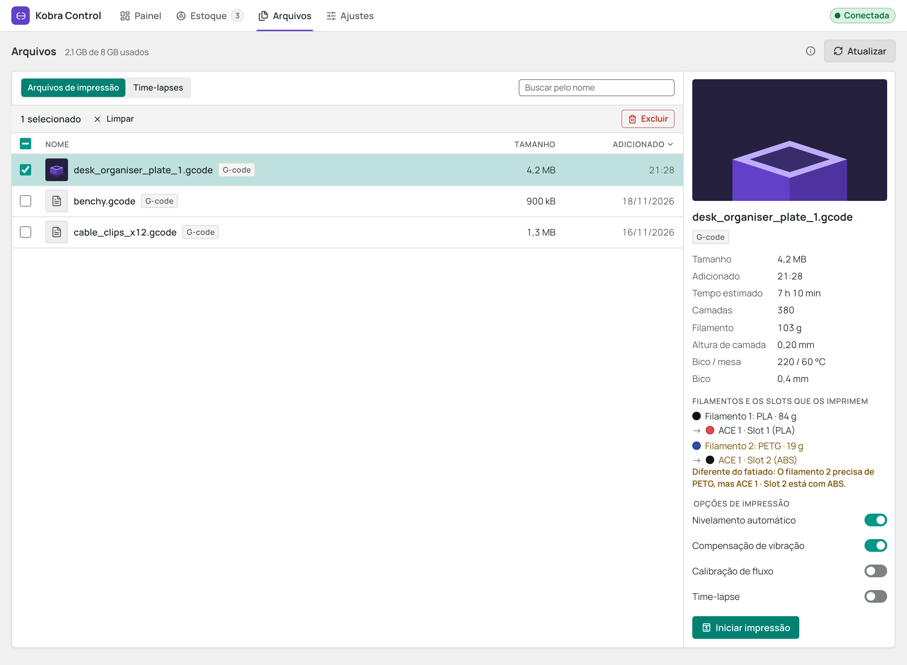
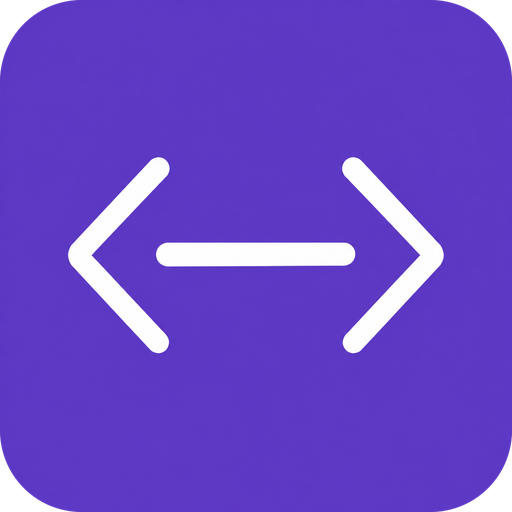

  <picture>
    <source media="(prefers-color-scheme: dark)" srcset="assets/readme/kobracontrol-hero-dark-pt-BR.png">
    
  </picture>

<h1 align="center">🟣 Kobra Control</h1>

<b>Controle a Anycubic Kobra X pelo OrcaSlicer na sua rede.</b> Um plugin para o OrcaSlicer · by bloodf

  
  
  
  

  <a href="#-instalação">Instalação</a> · <a href="#-recursos">Recursos</a> · <a href="#-como-usar">Como usar</a> · <a href="#-perguntas-frequentes">Perguntas frequentes</a> · <a href="README.md">English</a>

## ✨ O que faz

O Kobra Control (`kobracontrol`) é um plugin do OrcaSlicer 2.5 para a Anycubic Kobra X. Ele fala direto com a impressora pela rede local e registra um agente de impressora no OrcaSlicer, então os diálogos Print e Send e a aba Device do próprio OrcaSlicer funcionam com a Kobra X. Ele também cria a aba **Kobra Control**, com painel, câmera, os slots de filamento do ACE, os arquivos da impressora e o Spoolman. Não precisa de conta na nuvem nem de pacotes Python extras.

  <picture>
    <source media="(prefers-color-scheme: dark)" srcset="assets/readme/kobracontrol-dashboard-dark-pt-BR.png">
    
  </picture>

## 📦 Instalação

O Kobra Control está no Orca Cloud: abra [a página do plugin](https://cloud.orcaslicer.com/p/59c786285255) e assine. Assinar baixa o plugin, mas não o liga. Depois, no OrcaSlicer (os menus aparecem aqui com os nomes em inglês):

1. Abra a lista de plugins. No macOS: **File > Plugins** na barra de menus no topo da tela. No Windows e no Linux: clique na pequena seta **▾** ao lado de **File**, no canto superior esquerdo da janela do OrcaSlicer, e depois em **Plugins** (lá ele não fica dentro do menu File).
2. A primeira coluna da lista se chama **Activate**. Marque a caixa dessa coluna na linha do **Kobra Control**.
3. Permita o que o OrcaSlicer pedir. A aba **Kobra Control** aparece ao lado de Prepare, Preview e Device.

Para desligar, desmarque a mesma caixa. Para remover, selecione **Kobra Control** na mesma lista e desinstale por lá, ou cancele a assinatura no Orca Cloud.

A partir de um arquivo (os menus do OrcaSlicer aparecem aqui com os nomes em inglês):

1. Baixe `kobracontrol_any.whl` da [última versão](https://github.com/bloodf/kobracontrol/releases/latest).
2. No OrcaSlicer, abra a lista de plugins (macOS: **File > Plugins**; Windows e Linux: a seta **▾** ao lado de **File** > **Plugins**), escolha **Install local plugin** e o arquivo.
3. Marque a caixa dele na coluna **Activate** e permita o que o OrcaSlicer pedir. A aba **Kobra Control** aparece ao lado de Prepare, Preview e Device.

| Requisito | Detalhe |
|---|---|
| OrcaSlicer | 2.5.0 ou mais novo, na versão oficial. Não precisa de versão modificada. |
| Impressora | Uma Anycubic Kobra X na mesma rede, com o modo LAN ligado. Conferido no firmware 2.0.2.8. |
| `ffmpeg` | Opcional. A aba Kobra Control mostra a câmera com o player embutido; o `ffmpeg` só é necessário quando esse player não consegue (uma transmissão RTSP, ou um sistema sem suporte a vídeo H.264, possível no Linux). A câmera da aba Device funciona sem ele. |
| Anycubic Slicer Next | Não é necessário. O certificado de cliente que a impressora exige vem no plugin. |
| Spoolman | Opcional, para acompanhar as bobinas. |

### Conferido na impressora

Executado em uma Kobra X real pela camada de serviço do plugin, fora do OrcaSlicer. As datas vêm do [changelog](CHANGELOG.md) e de [docs/protocol.md](docs/protocol.md) (em inglês).

| O que foi conferido | Firmware | Data |
|---|---|---|
| Conexão, credenciais, status, slots do ACE, lista de arquivos, detalhes, envio e exclusão, luz, transmissão da câmera | 2.0.2.8 | 2026-11-14 |
| Homing, movimentos e aquecimento com a impressora parada | 2.0.2.8 | 2026-11-14 |
| Uma impressão a partir de um `.3mf` com mapeamento de slots, detecção do fim e o consumo de filamento do trabalho | 2.0.2.8 | 2026-11-14 |
| Como a impressora responde à busca na rede (SSDP) | 2.0.2.8 | 2026-11-15 |
| Listar os vídeos de time-lapse | 2.0.2.8 | 2026-11-16 |
| Excluir um vídeo de time-lapse | 2.0.2.8 | 2026-11-16 |

Ainda não experimentados na impressora: pausar, retomar, parar, alimentar e recolher filamento, secagem, edição de slot, pular objetos, modo de velocidade, registro de consumo no Spoolman, calibração de fluxo e time-lapse no início da impressão, o painel Impressora e o Print Assist, e as verificações do G-code. Nada foi testado dentro do próprio OrcaSlicer (aba Device, diálogo Print, diálogos de permissão).

O Kobra Control é um projeto independente. Não é feito nem mantido pela Anycubic.

## 🧰 Recursos

<table>
  <tr>
    <td width="50%" valign="top">
      
      
<b>Envie impressões pela rede local</b> Print e Send funcionam pelos diálogos do próprio OrcaSlicer. A aba encontra a impressora sozinha e o certificado de cliente já vem no plugin.

    </td>
    <td width="50%" valign="top">
      
      
<b>Acompanhe sua impressão</b> Progresso, camada, tempo restante e a hora em que a impressão deve terminar, ao lado de temperaturas, ventoinha, velocidade, luz e câmera.

    </td>
  </tr>
  <tr>
    <td width="50%" valign="top">
      
      
<b>Gerencie o filamento de cada slot</b> Cada slot da cabeça de impressão e do ACE mostra cor e material, com alimentar, recolher, alimentação automática, secagem e a bobina do Spoolman vinculada.

    </td>
    <td width="50%" valign="top">
      
      
<b>Escolha os arquivos antes de imprimir</b> Veja os arquivos da impressora e confira tempo, camadas, filamento e qual slot do ACE imprime cada cor antes de pressionar <b>Iniciar impressão</b>.

    </td>
  </tr>
</table>

| Recurso | O que você tem |
|---|---|
| Agente de impressora | O id do agente é `kobracontrol`. Depois do diálogo Print do OrcaSlicer, abre a janela de preparação do próprio Kobra Control, então são dois diálogos: o OrcaSlicer não tem como substituir o dele. A janela parte da escolha do OrcaSlicer e mostra o slot de cada filamento (só o mesmo material, com a bobina do Spoolman) e as opções de impressão, e envia exatamente isso. O Send usa só o diálogo do OrcaSlicer. Antes de enviar, ele lê o G-code fatiado e avisa quando falta o bloco de configurações ou uma imagem de prévia em PNG. |
| Aba Device | Status, temperaturas, pausar, retomar, parar, luz, ventoinha, velocidade e câmera na aba Device do próprio OrcaSlicer. Os slots do ACE aparecem ali como slots de filamento, com sincronização e mapeamento no diálogo de impressão. |
| Painel | A impressão com o progresso e as ações, os slots de filamento, um módulo Controles (temperaturas, ventilador, modo de velocidade, luz), a câmera, movimentos e homing, o painel Impressora e um Console (o que o plugin enviou e o que voltou). |
| Seu painel | **Editar layout** no Painel: arraste widgets para movê-los, arraste bordas ou cantos para redimensionar, remova, adicione da lista (também uma leitura de Temperaturas e um atalho para Arquivos) e ajuste os que têm configurações (formato da câmera, linhas do console, leituras mostradas). Guarde vários layouts com nome e alterne entre eles. Os layouts ficam salvos nas configurações do Kobra Control. |
| Estoque | O estoque de bobinas do Spooler em uma aba própria: escolha um slot à esquerda e use **Vincular** na linha da bobina. |
| Painel Impressora | Firmware, endereço de rede, contadores de impressão e as chaves do **Assistente de impressão**. O nome da impressora e **Renomear** ficam no cabeçalho da página. |
| Arquivos | Um navegador de arquivos: busca, ordenação por qualquer coluna, seleção de um ou vários arquivos e **Excluir** de uma vez (caixas de seleção, Shift e Ctrl/Cmd, ou o teclado). A Kobra X não tem pastas nem como mover um arquivo, então não há árvore de pastas nem **Mover para**. Selecione um arquivo para ver a imagem, os detalhes e as opções de impressão. O painel de impressão avisa quando um slot está com um material diferente do fatiado, quando um filamento não tem slot carregado e quando o arquivo foi fatiado para outra impressora. A confirmação repete o aviso. |
| Time-lapses | Os vídeos de time-lapse da impressora, como uma segunda lista na aba Arquivos (**Arquivos de impressão** | **Time-lapses** acima da tabela), com impressão, data, duração e tamanho, e **Excluir** para um ou vários. A impressora ainda não oferece um jeito de baixar um vídeo pela rede local. |
| Spoolman | Vincule uma bobina do Spoolman a um slot. As impressões concluídas registram ali o filamento usado quando a opção está ligada. |
| Funciona com o Spooler | O [Spooler](https://github.com/bloodf/spooler) transforma seus filamentos do Spoolman em perfis de filamento do OrcaSlicer. Com ele instalado, a aba Estoque mostra o estoque do Spooler. O Kobra Control também funciona ao lado do [Print Calculator](https://github.com/bloodf/orca_print_calculator). |
| Ajustes | Requisitos (ffmpeg, Anycubic Slicer Next, printer agents do OrcaSlicer e Spoolman: o que foi encontrado, quem precisa e como instalar), conexão (com a impressão digital do certificado da impressora), certificado, padrões de impressão, caminho do `ffmpeg`, Spoolman e idioma. Se a impressora apresentar um certificado TLS diferente do anterior, todas as abas mostram um aviso. |
| Plugins > Run | **Check Kobra X connection** informa certificado, credenciais, MQTT e versão do firmware. **Find Anycubic certificate** procura o certificado de cliente e informa o resultado. |

Não há suporte para: Anycubic Cloud e acesso de fora da rede local, console de G-code (o protocolo LAN da impressora não tem) e outros modelos Kobra.

## 🛠️ Como usar

1. Ligue o modo LAN na Kobra X e deixe a impressora e o computador na mesma rede.
2. Abra a aba **Kobra Control**. Ela procura a impressora sozinha. Na primeira vez, o OrcaSlicer pergunta uma vez se o kobracontrol pode se conectar àquele endereço. Permita.
3. Use o **Painel** para acompanhar a impressão, definir temperaturas, ligar a câmera com **Ligar** e alimentar, recolher ou secar filamento.
4. Para imprimir um arquivo guardado na impressora, abra **Arquivos**, pressione **Imprimir** no arquivo, confira o painel e pressione **Iniciar impressão**.
5. Para enviar impressões pelo próprio OrcaSlicer, abra **Preferences > Developer > Experimental Features**, marque **Use printer agents instead of print hosts** e reinicie o OrcaSlicer. Depois, em uma cópia do seu perfil de impressora da Kobra X, defina **Printer Agent** como `kobracontrol` e o endereço como o IP da impressora.
6. Execute **Plugins > Check Kobra X connection**. Depois, no diálogo de impressão do OrcaSlicer, sincronize os slots do ACE, associe cada filamento a um slot e envie a impressão.

  <picture>
    <source media="(prefers-color-scheme: dark)" srcset="assets/readme/kobracontrol-files-dark-pt-BR.png">
    
  </picture>

Os passos 5 e 6 são opcionais. Sem eles a aba funciona sozinha, por exemplo ao lado do Kobralink ou de outra ponte Moonraker que o seu perfil de impressora já usa, e Print, Send e a aba Device do OrcaSlicer continuam usando o agente do próprio perfil.

A aba procura a impressora nesta ordem: o endereço em **Ajustes**, se você definiu um; o endereço que ela encontrou antes para o perfil de impressora selecionado; o endereço do próprio perfil, se uma Kobra X responder ali; e por fim uma busca na rede local (SSDP, do jeito que o Anycubic Slicer Next encontra impressoras). Uma impressora encontrada pela busca só é usada depois que você a escolhe.

Depois que a impressão começa, a impressora pode passar muitos minutos em preparação (aquecendo, nivelando e passando pelos slots do ACE) antes da primeira camada. Em um teste isso levou cerca de 11 minutos para uma impressão de 5 minutos. A impressora não travou; enquanto isso o trabalho aparece como imprimindo.

O passo a passo completo e uma tabela de solução de problemas estão em [docs/setup.md](docs/setup.md) (em inglês).

## 🔒 Privacidade e segurança

### O que o plugin pode acessar

| Permissão do OrcaSlicer | Para que serve |
|---|---|
| Rede: o endereço da impressora e o grupo multicast 239.255.255.250 | HTTP na porta 18910 (credenciais, envio do G-code), MQTT com TLS na porta 9883 (status e comandos) e a busca na rede. O OrcaSlicer pergunta uma vez por impressora encontrada depois. |
| Rede: o endereço do seu Spoolman, só se você definir um | Vínculos de bobina e consumo de filamento. |
| Leitura: a pasta temporária do OrcaSlicer | O arquivo fatiado que Print e Send entregam. Ele é lido, verificado e enviado como está, nunca alterado. |
| Leitura: os arquivos do Anycubic Slicer Next, só quando você toca em **Procurar certificado** | O certificado de cliente dele. O OrcaSlicer pergunta antes. |
| Execução: `ffmpeg`, só para a câmera da aba | Transformar a transmissão da impressora em imagens. O OrcaSlicer mostra o comando e pergunta. |
| Threads | O trabalho de rede fora da thread principal do OrcaSlicer. |

Arquivos de impressão e comandos vão para a impressora, vínculos de bobina e consumo vão para o Spoolman, e nada vai para outro lugar. Não há telemetria nem coleta de uso. O plugin grava arquivos só na própria pasta de armazenamento (ajustes, o registro de impressões, as impressoras encontradas) e lê a lista de estoque do Spooler quando o Spooler está instalado.

### Rede e certificado

O Kobra Control se conecta só à Kobra X e ao seu servidor Spoolman, se você configurar um. A impressora é acessada por HTTP na porta 18910 e por MQTT com TLS mútuo na porta 9883, no endereço que você definiu ou em um que o plugin encontrou na rede local e confirmou ser uma Kobra X em modo LAN. A busca na rede envia consultas SSDP apenas para o grupo multicast local 239.255.255.250. Não existe serviço na nuvem.

Use em uma rede em que você confia. A impressora entrega as credenciais MQTT a qualquer um na rede, e o certificado TLS dela é autoassinado e não é verificado, então a conexão só protege contra leitura passiva.

A impressora só aceita o certificado de cliente TLS que acompanha o Anycubic Slicer Next. Esse certificado é uma identidade de cliente compartilhada, igual em todas as cópias do Anycubic Slicer Next, e não um segredo de cada usuário; o plugin já vem com ele. Nem a chave desse certificado nem as credenciais MQTT são enviadas à página ou gravadas em logs.

Na aba, parar uma impressão, aquecer, fazer homing, desligar os motores, pular objetos, alimentar ou recolher filamento, iniciar uma secagem, imprimir um arquivo guardado e excluir arquivos sempre pedem confirmação. Os detalhes estão em [SECURITY.md](SECURITY.md) (em inglês).

## ❓ Perguntas frequentes

Preciso ter o Anycubic Slicer Next instalado?

Não. O certificado de cliente vem no plugin, então não há etapa de certificado. Se um firmware futuro deixar de aceitar a cópia incluída, **Procurar certificado** (em **Ajustes**, na opção avançada do certificado) troca essa cópia pela da sua instalação do Anycubic Slicer Next.

A impressão começou, mas nada se mexe por vários minutos. Travou?

Não. A impressora aquece, nivela e passa pelos slots do ACE antes da primeira camada. Em um teste isso levou cerca de 11 minutos para uma impressão de 5 minutos.

Posso continuar usando o Kobralink ou outra ponte Moonraker?

Pode. Deixe o seu perfil de impressora como está. A aba Kobra Control encontra a impressora e funciona sozinha, e Print, Send e a aba Device do OrcaSlicer continuam passando pela ponte. Quando o endereço do perfil é de uma ponte e não da impressora, a aba avisa em uma linha.

Por que o OrcaSlicer pede permissão para executar o ffmpeg?

Só quando o player embutido não consegue mostrar a câmera a aba Kobra Control usa o `ffmpeg` para transformar a transmissão da impressora em imagens. Quando ele inicia, o OrcaSlicer mostra o comando completo, com o endereço da transmissão, e pergunta. Ele pergunta de novo quando esse endereço muda, o que acontece quando a impressora reinicia. A câmera da aba Device não precisa do `ffmpeg`.

Nada conecta, ou aparece "No Kobra X answered the network search".

Confira se o modo LAN está ligado na impressora e se ela e o computador estão na mesma rede. Se a sua rede bloqueia multicast, digite o IP da impressora em **Ajustes > Endereço da impressora**.

"Something answers at … but it is not a Kobra X in LAN mode".

O endereço é de outro aparelho, muitas vezes uma ponte como o Kobralink, ou o modo LAN está desligado. Deixe **Ajustes > Endereço da impressora** em branco para a aba procurar, ou digite ali o IP da própria impressora.

O perfil de impressora não tem o Printer Agent kobracontrol.

**Use printer agents instead of print hosts** está desligado. Ligue em **Preferences > Developer > Experimental Features** e reinicie o OrcaSlicer.

"Could not connect to OctoPrint" ao imprimir na Kobra X.

A Kobra X não tem servidor OctoPrint, então uma impressora física do tipo OctoPrint apontada para o endereço da própria impressora não a alcança. Dois caminhos:

- **Imprimir pelo agente de impressora do Kobra Control** (recomendado). Remova essa impressora física, marque **Use printer agents instead of print hosts** em **Preferences > Developer > Experimental Features**, reinicie o OrcaSlicer e defina **Printer Agent** como `kobracontrol` numa cópia do seu perfil de impressora da Kobra X. O endereço da impressora é opcional ali: o Kobra Control encontra a impressora na rede.
- **Manter a impressora física OctoPrint, mas apontá-la para o Kobra Control.** Na aba Kobra Control abra **Ajustes > Ponte de envio**, ligue a ponte e copie os dois valores que ela mostra (cada um tem um botão **Copiar**) para a impressora física: **Hostname, IP or URL** `127.0.0.1:8765` (não o IP da impressora) e **API Key / Password** a chave da ponte. Clique em **Test**. Enviar e imprimir então espera na aba Kobra Control até você clicar em **Iniciar impressão**.

O Painel avisa, com um botão para a ponte de envio, quando o perfil da Kobra X selecionado envia para o OctoPrint.

Um carretel pode usar o meu próprio perfil de filamento ajustado?

Sim, pela sincronização do AMS do OrcaSlicer. No Spoolman, adicione um campo extra de texto com a chave `orca_filament_preset` em carretéis ou filamentos (**Settings > Extra fields**) e escreva nele o nome do seu perfil; o valor do carretel vale mais que o do filamento. Precisa ser um perfil seu e compatível com a impressora. A sincronização só carrega um perfil independente (que não herda de nenhum, como uma cópia desvinculada); um perfil criado com **Salvar como** herda do pai e a sincronização carregaria o pai, então o slot fica com o perfil de sempre. Um nome não encontrado mostra um aviso uma vez. Detalhes em [docs/setup.md](docs/setup.md#8-use-your-own-filament-preset-for-a-spool-optional).

Dá para baixar os vídeos de time-lapse?

Ainda não. Não se conhece um jeito de a impressora entregar um vídeo pela rede local, então a aba só lista e exclui.

## 🌍 Idiomas

Inglês, português do Brasil, espanhol, alemão, chinês simplificado e polonês. A aba segue o idioma do OrcaSlicer, e **Ajustes > Idioma** muda isso.

## 🧩 Mais plugins do bloodf

| | Plugin | O que faz | |
|:-:|---|---|---|
|  | 🧩 [Organizer](https://github.com/bloodf/orca_organizer) | Organize as peças pelo contorno real e encha a mesa com mais cópias. | [Instalar](https://cloud.orcaslicer.com/p/5bf381fd42d4) |
|  | 🧲 [Embedder](https://github.com/bloodf/embedder) | Bolsos para ímãs e NFC, com a pausa na camada certa. | [Instalar](https://cloud.orcaslicer.com/p/58222d4f9e52) |
|  | 💰 [Print Calculator](https://github.com/bloodf/orca_print_calculator) | Preço de cada mesa: filamento, energia, mão de obra, taxas e margem. | [Instalar](https://cloud.orcaslicer.com/p/521c07cf6de2) |
|  | 🧵 [Spooler](https://github.com/bloodf/spooler) | Seu estoque do Spoolman dentro do OrcaSlicer, com o que resta em cada bobina. | [Instalar](https://cloud.orcaslicer.com/p/50c35dcbd6f3) |
|  | 🟣 **Kobra Control** · você está aqui | Controle a Anycubic Kobra X pelo OrcaSlicer na sua rede. | |
|  | 🔵 [U1 Control](https://github.com/bloodf/u1control) | Controle a Snapmaker U1 pelo OrcaSlicer: cabeças, câmera, arquivos. | [Instalar](https://cloud.orcaslicer.com/p/55b8c347d443) |

Cada plugin funciona sozinho; instalados juntos, compartilham dados onde ajuda.

## 🤝 Contribuir

Relatos de problemas, logs e pull requests são bem-vindos. Comece pelo [CONTRIBUTING.md](CONTRIBUTING.md). A documentação para desenvolvedores fica em [docs/](docs/) e está em inglês: [configuração](docs/setup.md), [arquitetura](docs/architecture.md), [protocolo](docs/protocol.md), [publicação](docs/release.md) e a [descrição do Orca Cloud](docs/orca-cloud-description.md). Veja também o [histórico de mudanças](CHANGELOG.md), as [notas de segurança](SECURITY.md) e o [NOTICE.md](NOTICE.md), com os créditos dos projetos de onde o código do protocolo foi portado.

## 📄 Licença

GPL-3.0-only. Veja o [LICENSE](LICENSE).

by bloodf

