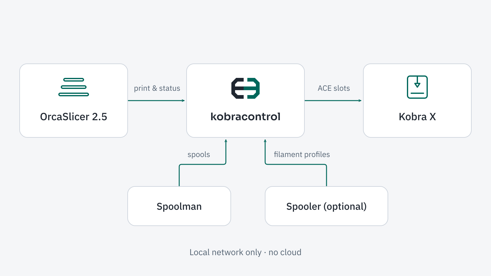
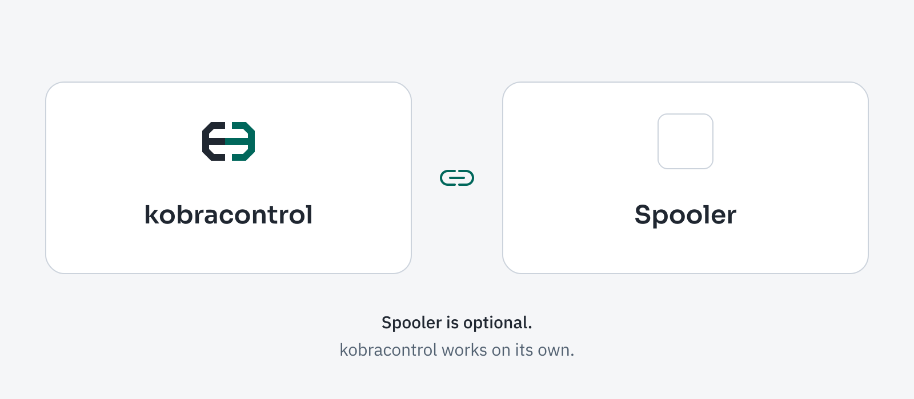

# Architecture

kobracontrol ships as a pure-Python wheel, `kobracontrol_any.whl`, which OrcaSlicer loads as a
plugin. The sources live in `src/kobracontrol/`, and `scripts/build.py` packs them.

## How it works

<picture>
  <source media="(prefers-color-scheme: dark)" srcset="../assets/diagrams/how-it-works-dark.png">
  
</picture>

kobracontrol connects to the printer over HTTP on port 18910 and MQTT over mutual TLS on port 9883.
The printer must have LAN mode enabled. The printer only accepts the TLS client certificate that
Anycubic Slicer Next carries. This is a shared client identity, the same in every copy of Anycubic
Slicer Next, not a per-user secret; kobracontrol bundles it so the plugin connects out of the box.
If a future firmware stops accepting the bundled copy, **Find certificate** (Settings, under the
certificate's advanced option) replaces it with the one from your own Anycubic Slicer Next install.

The tab finds the printer by itself: the address in Settings if you set one, else the address it found
before for the selected printer preset, else the preset's own address if a Kobra X answers there, else
a search of the local network (SSDP, the way Anycubic Slicer Next finds printers). The protocol is
described in [protocol.md](protocol.md).

### Works with Spooler

<picture>
  <source media="(prefers-color-scheme: dark)" srcset="../assets/diagrams/kobracontrol-works-with-spooler-dark.png">
  
</picture>

[Spooler](https://github.com/bloodf/spooler) turns your Spoolman filaments into OrcaSlicer filament
profiles. With Spooler installed, kobracontrol shows Spooler's stock on the Dashboard. Each plugin
works on its own.

## Modules

| Module | Job | Uses `orca`? |
|---|---|---|
| `aes.py` | AES-128-CBC, for the printer's credential answer | no |
| `mqtt.py` | Minimal MQTT 3.1.1 client over TLS | no |
| `certs.py` | Finds, saves and loads the Anycubic Slicer client certificate; builds the TLS context | no |
| `kobra.py` | Credential recovery, printer commands, upload, print start, `State` (reports folded into one view) | no |
| `ace.py` | ACE and print-head slot model, slot mapping for a print, drying | no |
| `bambu.py` | Translates the view to the Device tab's status JSON and Device tab commands to printer commands | no |
| `camera.py` | Camera start and, for the tab, `ffmpeg` to JPEG frames | no |
| `files.py` | Printer file list, details, delete, print; time-lapse video list and delete | no |
| `spoolman.py`, `peers.py`, `spooler_bridge.py`, `stockview.py`, `usage.py` | Spoolman, Spooler presence and stock, filament use | no |
| `settings.py` | Settings store | no |
| `connection.py` | One connection and one state per printer address, with the reconnect loop; certificate search | no |
| `locate.py` | Where the printer is: Settings address, remembered printer, preset address, SSDP search; the address book (`addresses.json`) | no |
| `locating.py` | The service side: locate threads, printer switch on a new address, identity and certificate checks, relocation limits | no |

Filament use (`usage.py`) is booked by Kobra Control in its Spoolman, which is Spooler's when none is set
here. Spooler 0.26 never books a Kobra X print: its Kobra link reads only slots (`kx_report` gives no print
state, so `usage_track` never runs for it). A Spooler that does must list `"anycubic"` in its presence
`provides.books`; Kobra Control then does not book in that same Spoolman (`Target.spoolman_report_usage`).
| `gcode_check.py` | Read-only checks of the plate G-code (settings block, PNG preview) and of the printer preset | no |
| `jobs.py` | Print and Send: plate G-code streamed from the sliced `.3mf` to the printer, then print start | no |
| `service.py` | The connections, shared by the printer agent and the tab; command worker; monitor | no |
| `plugin.py` | OrcaSlicer glue: printer agent, tab, scripts | yes |
| `ui/app.html` | The Kobra Control tab: one compiled Vue 3 + PrimeVue page, built from `ui/` | - |

Only `plugin.py` imports `orca`, so everything else is tested without OrcaSlicer.

## Capabilities

| Name | OrcaSlicer type | Where it shows |
|---|---|---|
| Anycubic Kobra X (kobracontrol) | Printer agent, id `kobracontrol` | Printer preset > Printer Agent; then Print, Send and the Device tab |
| Kobra Control | Pages | a tab next to Prepare / Preview / Device |
| Check Kobra X connection | Script | Plugins > Run |
| Find Anycubic certificate | Script | Plugins > Run |

## Connection

`service.py` owns the connections (`connection.py`). For a printer address it loads the saved certificate, recovers the
MQTT credentials from the printer (`kobra.fetch_credentials`; kept in memory only, never written to
disk), connects, subscribes and feeds every report into one `kobra.State`. The printer agent and the
tab are two consumers of that one connection and one state. The scripts use it too: the plugin
never opens a second MQTT session to a printer. This is the plugin's own choice; on firmware 2.0.2.8
the printer accepted a second client (Kobralink) at the same time. When the connection drops the service reconnects
with a growing delay (2 s doubling to 60 s, reset only after a session has lasted 30 s), recovering
the credentials again each time. Only the user's Retry, Find certificate and a print job cut that delay short; the
page's statuses and hellos never do. The certificate comes from the plugin's data folder or the copy bundled with it;
Anycubic Slicer Next's folders are read only when the user runs Find certificate.

On connect the plugin sends three status queries and nothing else. After that it polls status. The
one thing it sends without a user command is the "feed finished" acknowledgement the printer waits
for after a filament load or unload, as both upstream bridges do.

No printer traffic runs on OrcaSlicer's threads: the UI thread, the slicing thread and the agent's
callbacks only queue work and return.

## Page protocol

The page and the plugin exchange JSON through `orca.postMessage` and `post_message`.

Page to plugin:

| type | fields | effect |
|---|---|---|
| `hello` | `id`, `retry` | resolve the printer, connect, send `config`; a connection that already failed answers its last error at once and keeps its retry delay, unless `retry` is `true` (the page's Retry button), which tries again now and answers at that attempt's result; the result carries `source` (`override`, `remembered`, `preset`, `discovered`) and `note` (one line when the preset's address was not the printer); when no Kobra X is found the error reply has `no_target: true` and `candidates` (`[{ip, name, model}]`, when several answered: the page offers them and sends `cmd choose_printer {host}`) and `pending` (addresses found that OrcaSlicer does not let the plugin reach yet: the page sends `allow_hosts {id, hosts}` once, which the plugin handles on the UI thread so OrcaSlicer's dialog shows at once and a Yes is saved, then says hello again); `cmd search_printer` searches again; with no certificate it has `no_certificate: true`. The `offline` message carries `retry_at` (unix s of the next automatic attempt, 0 when none is planned) |
| `lease` | `camera`, `stock` | keep status updates coming (renewed every 2 s, lapses after 6 s); camera on or off; `stock`: the Stock card is on screen |
| `cmd` | `id`, `cmd`, `args`, `gen` | run `Service.cmd_<cmd>(**args)` for printer generation `gen` |
| `frame_ack` | | the page has shown the last camera frame |
| `save_settings` | `id`, `settings` | validate and store settings |
| `ui_language` | `value` | store the page's language choice |
| `check_requirements` | | look for ffmpeg and Anycubic Slicer Next again (Settings > Requirements > Check again); answered with `requirements` |

Plugin to page:

| type | fields |
|---|---|
| `reply` | `id`, `result` or `error` |
| `status` | `data` (below), `gen` |
| `frame` | `image` (JPEG data URL) |
| `camera_error` | `error`, `reason` (`no_ffmpeg`, `no_stream`, `failed`) |
| `config` | `settings`, `certificate` (`{found, source}`), `spooler`, `version`, `limits` (`{nozzle_max, bed_max}`) |
| `requirements` | `checking`, `items` (`[{id, state, details}]`: `id` `ffmpeg`, `anycubic_slicer`, `printer_agents`, `spoolman`, `certificate`, `spooler` (the last two as the config just read them); `state` `ok`, `missing`, `unknown` = not checked yet; for `printer_agents` `missing` means not detected). Sent after `hello`, `save_settings` and `check_requirements` (each also sends `config` first), and when a check finishes. The file checks run once on their own thread (requirements.py) and are cached until Check again or a Settings save; without ffmpeg the monitor never starts the camera |
| `notice` | `text` |
| `offline` | `error` |
| `selection_changed` | |

### `status.data`

Every key of `kobra.State.view()` (see the docstring of `kobra.py`) except `file_details`; `upload_url`
is always empty, because it carries the upload token. Plus:

| key | value |
|---|---|
| `mode` | `toolhead`, `ace_direct` or `ace_hub` (`ace.detect_filament_mode`) |
| `slots` | `ace.aggregate_slots` slots (including `percent`, `weight`, `brand` and `material_name`), each with `activity` filled, plus `tray` (`ace.tray_id`), `usable` (`ace.slot_usable_for_print`) and `spool_id` (bound Spoolman spool or `null`) |
| `loaded_slot` | `global_index` of the loaded slot, or -1 |
| `ace_units` | `ace.aggregate_ace_units` units: `{id, auto_feed, humidity, temp, status, model_id, drying}`; `drying.remain_time` is in minutes |
| `mac`, `stats`, `assist` | from `kobra.State.view()`: the network address (`""` until reported), the counters the printer reported (`print_minutes`, `print_count`, `filament_g`; absent when not reported) and the Print Assist switches by option number (`null` until the printer answered). Not yet seen from a Kobra X |
| `features`, `aux_fan_pct`, `phase_unit`, `phase_channel` | from `kobra.State.view()`: the `*_support` flags, the auxiliary fan percentage, and the ACE unit and slot (1-based) of the current slot check during a job, or `null` |
| `can` | `{pause, resume, stop, move, heat, feed, print}` booleans: what the printer state allows now |
| `tls` | `{fingerprint, changed_from}`: SHA-256 (hex) of the certificate the printer presented on this session, and the one remembered from before when it differs (else `""`); `null` without TLS. See SECURITY.md |

### Commands

| `cmd` | `args` | Asks first in the UI |
|---|---|---|
| `connect` | | |
| `pause`, `resume` | | |
| `stop` | | yes |
| `set_temp` | `nozzle`, `bed` (either may be absent; 0 turns off) | yes when heating |
| `set_fan` | `pct` 0-100 (`fan/setSpeed`; while printing also `print/update`) | |
| `set_light` | `on` | |
| `set_speed` | `mode`: 1 quiet, 2 standard, 3 sport; only while printing | |
| `move` | `axis` (`x`, `y`, `z`), `distance` (mm, signed, at most 50) | |
| `home` | `axes` (`xy`, `z` or `xyz`) | yes |
| `motors_off` | | yes |
| `objects` | | |
| `skip_objects` | `names` (each must be an object of the running file) | yes |
| `slot_set` | `slot` (global index), `type`, `colour` (`#RRGGBB`) | |
| `slot_feed`, `slot_retract` | `slot` | yes |
| `auto_feed` | `ace` (unit id), `on` | |
| `dry_start` | `aces`, `temp`, `minutes` | yes |
| `dry_stop` | `aces` | |
| `device` | (read only) asks for the network address, counters and Print Assist; idle printer only; the answers come in the status | |
| `assist` | `option` (`breakAlert`, `jamAlert`, `remain`, `belt`, `lostStep`, `autoFeed`), `on`; idle printer only | yes |
| `rename` | `name` (1-32 UTF-8 bytes, no quotes, backslashes or angle brackets); idle printer only | yes |
| `files` | | |
| `file_details` | `name` | |
| `file_print` | `name`, `auto_leveling`, `vibration_compensation`, `flow_calibration`, `timelapse` | yes |
| `file_delete` | `names` | yes |
| `videos` | (the time-lapse videos; also while printing) | |
| `video_delete` | `name` (one video's file name: a plain name ending `.mp4`, at most 255 characters); also while printing | yes |
| `find_certificate` | `path` (optional file or folder) | |
| `spools` | | |
| `bind`, `unbind` | `slot`, `spool_id` | |
| `stock` | `refresh` (optional) | |
| `stock_assign` | `slot`, `spool_id`, `key` (the row's key from the `stock` reply) | yes |
| `usage`, `usage_ack` | the ledger of filament use still to be booked in Spoolman; no page surface yet | |

Replies:

| `cmd` | `result` |
|---|---|
| `files` | `{files: [{name, size, timestamp, thumbnail}]}`; storage is in `status.data.storage` |
| `file_details` | `{name, thumbnail, info, materials}`: thumbnail is a PNG data URL or `null`; `info` is `{estimated_s, layers, filament_g, layer_height, nozzle_temp, bed_temp, nozzle, printer_model, model_ok}` (numbers `null` when the file does not say); `materials` is one `{paint_index, material, colour, grams, slot, slot_type, slot_colour, check}` per filament, where `slot` is the `global_index` a print from the Files page would use (the same auto mapping as `file_print`, `null` when none) and `check` is `ok`, `differs` or `missing` (`files.plan`) |
| `file_print` | `{started: name}`; uses the automatic slot mapping from the loaded slots |
| `videos` | `{videos: [{filename, name, created, duration, size, empty}]}`, newest first: `name` is the print, `created` unix seconds, `duration` seconds, `size` bytes, `empty` true when nothing was recorded (duration 0). No cover picture and no download: the printer has no known LAN route for either |
| `video_delete` | `{deleted: name}`; the page then asks for `videos` again |
| `objects` | `{filename, objects: [name], skipped: [name]}` for the running print; an error when none runs |
| `find_certificate` | `{found, source}` |
| `spools` | `{spools, bindings}` |
| `stock` | the stock list plus `available` and `reason` (`null`, `absent`, `stale`, `waiting`, `unsupported`); rows carry `bound_slot` |

A command ends in one of three ways, from the printer's reply (`Service._answer`): confirmed
(`{confirmed: true}`, the printer reported success); a printer-reported failure or no answer at all
(an error carrying the printer's code and message, or `no_answer`); received but no result in time
(`no_result` error, or `{confirmed: false}` for `pause`, `stop` and `home`, where the next status
shows what happened). Homing waits for the printer's answer, which comes when it has finished, up to
90 s.

`stop` and `pause` run on their own short-lived thread so they never wait behind another command.
A command the printer state does not allow is refused by the service with a plain error, whatever
the page shows.

To add a command, write `cmd_<name>` in `service.py`, call it from the page with
`run({cmd: "<name>", ...})` (`ui/src/app/store.ts`), run `npm run build` in `ui/`, and add a test
that drives it against `tests/fake_kobra.py`.

## OrcaSlicer permissions

OrcaSlicer audits what plugin code does. Off the main thread it denies file reads that were not
granted and every temp-file creation, and it matches a `urllib` request by its full URL. The plugin
is written around that:

- It asks at load for: threads; read access to OrcaSlicer's own temp tree, where the sliced `.3mf`
  lives (`plugin.slicer_temp_root()`); network access to the printer addresses its own files name (the
  Settings address and the addresses found before, `addresses.json`) and to the SSDP multicast group
  `239.255.255.250` for the network search (a canonical `http://host` grant also covers raw sockets,
  docs/HLSD/plugin-permissions.md). It never reads the printer preset at load: OrcaSlicer loads plugins on a
  thread of its own while its UI thread is still loading the presets (GUI_App.cpp), so that read races it.
  The preset's address and the Device tab's printer are asked about later on the UI thread (the tab's hello,
  Save, `connect_printer`), the same way as `allow_hosts` below; a Yes saved earlier passes silently. An
  address refused there is asked about again only on a user action (Save, `connect_printer`, the Check
  script), never on the tab's own hello. The Check Kobra X connection script runs on a worker thread, so it
  has the UI thread read the preset through `queue_on_main` (waiting at most 5 s); without it, it uses what
  the tab last read. Nothing for Anycubic Slicer Next: the bundled
  certificate is read from the plugin's own package (inside `data_dir()`, no grant needed). Find
  certificate reads Anycubic Slicer Next only when the user asks; OrcaSlicer then asks about that one file.
- No `chmod` and no `open()` of a file descriptor: OrcaSlicer's audit sees no path in those events and
  asks for an event grant (`os.chmod`, `open`). Private files are created 0600 by path and renamed into
  place (`certs._write_private`).
- It creates files only inside its storage folder. The certificate copy is in `<storage>/tls`
  (OrcaSlicer refuses folders named `cert`, `certs`, `config` or `secret`).
- Print and Send stream the plate G-code out of the `.3mf` straight to the printer; no temp file.
- All printer HTTP goes through `http.client`, so one grant of the printer's address covers the
  credential calls, the upload and MQTT.
- A printer address entered after load is not granted yet: OrcaSlicer shows its dialog on the first
  attempt, and the connection error says to allow it and retry.
- A printer address found by the search is not probed from the search thread until granted: off the UI
  thread every refused attempt would queue one more OrcaSlicer dialog (`request_permission`,
  PluginAuditManager.cpp, posts a prompt per denied event with no de-duplication). The page asks the
  plugin (`allow_hosts`) to raise the audited event on the UI thread instead (`socket.getaddrinfo` of the
  numeric address, no network I/O): the dialog shows at once, a Yes is saved, and the tab connects. Checked
  against OrcaSlicer 2.5.0: page messages arrive on the UI thread (PluginHostUi.cpp, the WebKit backends
  deliver script messages from the native callback; PluginPages.cpp:148 calls `on_message`), inside an audit
  scope (PagesPluginCapabilityTrampoline.hpp, `ORCA_PY_AUDIT_SCOPE`); CPython raises `socket.getaddrinfo`
  before any lookup; PluginAuditManager.cpp maps it to the Socket category with the host as target (lines
  110, 1181), prompts inline on the UI thread and saves the Yes (1764-1765, 1842) to `network_socket`, which
  `has_network_permission` (1450) and `network_permission_matches` (313, bare host and address tuple, 356)
  also apply to the later `http.client.connect` and `socket.connect` to that host. Not yet seen in a real
  OrcaSlicer; if no Yes comes back, the page says to allow the address and press Search again. Without a
  click the page raises that dialog at most once per session, and only for a single new printer with none
  remembered for the preset.
- OrcaSlicer's network grants are exact hosts: `network_permission_matches` (PluginAuditManager.cpp:313)
  compares one host per entry, and the Plugins dialog refuses wildcards (docs/HLSD/plugin-permissions.md,
  "Persistence and editing"). There is no CIDR or "local network" grant, so the found printer's address
  cannot be declared at load before it is known.
- The tab's camera starts `ffmpeg`, which OrcaSlicer matches by its full command line.

`tests/audit_guard.py` models these checks so the tests run Print, Send, Find certificate and
connect under them. It is a model: only a real OrcaSlicer shows the real behaviour.
