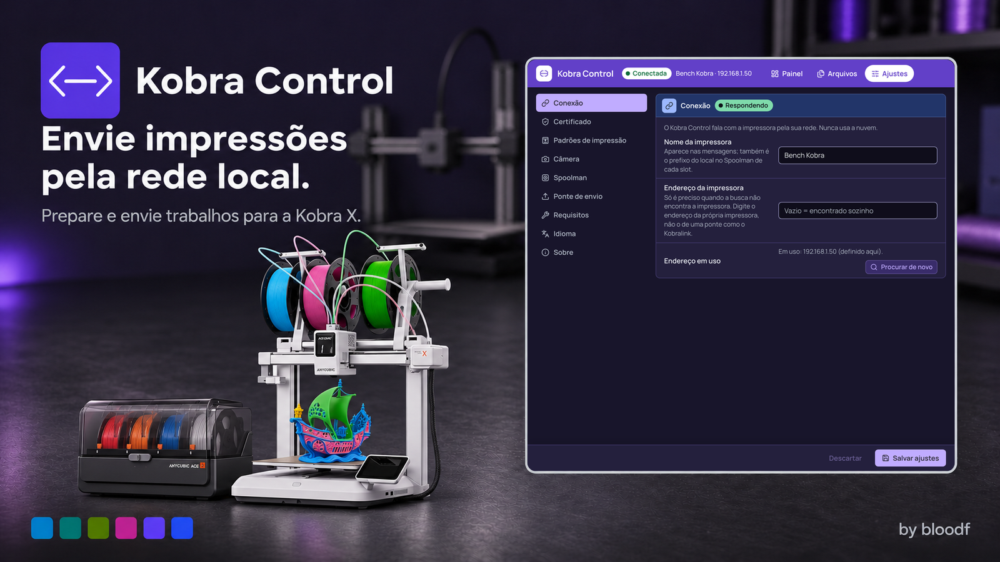

# Orca Cloud description

The listing text for <https://cloud.orcaslicer.com/p/59c786285255>: paste the English block into the English description and the Portuguese block into the Portuguese one. Each block stays under 4000 characters. The four pictures are read from `main` on `raw.githubusercontent.com`, so they show once the commit that adds them is merged. Which image goes in which listing slot is in [release.md](release.md). Keep the plugin list in step with the README's "More plugins by bloodf".

## English

```markdown
Run the Anycubic Kobra X from OrcaSlicer over your LAN.

## What you need

- OrcaSlicer 2.5.0 or newer.
- An Anycubic Kobra X on the same network, with LAN mode enabled (checked on firmware 2.0.2.8).
- `ffmpeg`, only for the camera in the Kobra Control tab.

Anycubic Slicer Next is not required: the client certificate the printer asks for is bundled.

## What it does


Print and Send from OrcaSlicer's own dialogs, with the filament-to-slot mapping you pick there.


Status, temperatures, pause, resume, stop, light, fan, speed and camera, in the Device tab and in a Kobra Control tab.


ACE slots with feed, retract, auto-feed and drying, and a Spoolman spool linked to each slot.


The printer's files, with time, layers, filament and slot mapping shown before you print, and the time-lapse videos.

## Verified on the printer

On a Kobra X with firmware 2.0.2.8, outside OrcaSlicer: connecting, status, ACE slots, files, camera and a print from a `.3mf` with a slot mapping (2026-11-14); the network search (2026-11-15); listing and deleting time-lapse videos (2026-11-16). Not tried on the printer yet: pause, resume, stop, feed, retract and drying. Nothing has been tested inside OrcaSlicer itself.

## How to start

1. Install the plugin and tick Activate. The Kobra Control tab appears next to Prepare, Preview and Device.
2. Turn on LAN mode on the printer. The tab finds it on your network; allow the address when OrcaSlicer asks.
3. To print from OrcaSlicer's own Print dialog, tick Preferences > Developer > Experimental Features > Use printer agents instead of print hosts, restart OrcaSlicer and set the printer preset's Printer Agent to `kobracontrol`.

## Privacy

Kobra Control connects only to your Kobra X and, if you set one, your Spoolman server. It has no cloud service and no telemetry.

What OrcaSlicer is asked to allow: network access to the printer's address and the local multicast group 239.255.255.250, and to your Spoolman address if you set one; reading OrcaSlicer's temporary folder, where the sliced file is read and checked but never changed; reading Anycubic Slicer Next only when you press Find certificate; running `ffmpeg` for the tab's camera.

Use it on a network you trust: the printer's LAN protocol hands out its credentials to anyone on the network.

Independent project, not made or supported by Anycubic.

## Languages

English, Brazilian Portuguese, Spanish, German, Simplified Chinese and Polish.

## More plugins by bloodf

- [Organizer](https://cloud.orcaslicer.com/p/5bf381fd42d4): Arrange parts by their real outline and fill a plate with more copies.
- [Embedder](https://cloud.orcaslicer.com/p/58222d4f9e52): Magnet and NFC pockets, with the pause at the right layer.
- [Print Calculator](https://cloud.orcaslicer.com/p/521c07cf6de2): Price every plate: filament, energy, labour, fees and margin.
- [Spooler](https://cloud.orcaslicer.com/p/50c35dcbd6f3): Your Spoolman stock inside OrcaSlicer, with what is left on each spool.
- [U1 Control](https://cloud.orcaslicer.com/p/55b8c347d443): Run the Snapmaker U1 from OrcaSlicer: toolheads, camera, files.

Each plugin works on its own; installed together they share data where it helps.

## Source code

https://github.com/bloodf/kobracontrol (GPL-3.0-only)
```

## Português (Brasil)

```markdown
Controle a Anycubic Kobra X pelo OrcaSlicer na sua rede.

## O que você precisa

- OrcaSlicer 2.5.0 ou mais novo.
- Uma Anycubic Kobra X na mesma rede, com o modo LAN ligado (conferido no firmware 2.0.2.8).
- `ffmpeg`, só para a câmera da aba Kobra Control.

O Anycubic Slicer Next não é necessário: o certificado de cliente que a impressora exige vem no plugin.

## O que faz



Print e Send pelos diálogos do próprio OrcaSlicer, com o mapeamento de filamento para slot que você escolhe ali.


Status, temperaturas, pausar, retomar, parar, luz, ventoinha, velocidade e câmera, na aba Device e na aba Kobra Control.


Slots do ACE com alimentar, recolher, alimentação automática e secagem, e uma bobina do Spoolman vinculada a cada slot.


Os arquivos da impressora, com tempo, camadas, filamento e os slots de cada cor antes de imprimir, e os vídeos de time-lapse.

## Conferido na impressora

Em uma Kobra X com firmware 2.0.2.8, fora do OrcaSlicer: conexão, status, slots do ACE, arquivos, câmera e uma impressão a partir de um `.3mf` com mapeamento de slots (2026-11-14); a busca na rede (2026-11-15); listar e excluir vídeos de time-lapse (2026-11-16). Ainda não experimentados na impressora: pausar, retomar, parar, alimentar, recolher e secagem. Nada foi testado dentro do OrcaSlicer.

## Como começar

1. Instale o plugin e marque Activate. A aba Kobra Control aparece ao lado de Prepare, Preview e Device.
2. Ligue o modo LAN na impressora. A aba a encontra na sua rede; permita o endereço quando o OrcaSlicer perguntar.
3. Para imprimir pelo diálogo Print do próprio OrcaSlicer, marque Preferences > Developer > Experimental Features > Use printer agents instead of print hosts, reinicie o OrcaSlicer e defina o Printer Agent do perfil de impressora como `kobracontrol`.

## Privacidade

O Kobra Control se conecta só à sua Kobra X e, se você configurar, ao seu servidor Spoolman. Não existe serviço na nuvem nem telemetria.

O que o OrcaSlicer vai pedir: acesso de rede ao endereço da impressora e ao grupo multicast local 239.255.255.250, e ao seu Spoolman, se houver; leitura da pasta temporária do OrcaSlicer (o arquivo fatiado é lido, nunca alterado); leitura do Anycubic Slicer Next só quando você toca em Procurar certificado; execução do `ffmpeg` para a câmera da aba.

Use em uma rede em que você confia: o protocolo LAN da impressora entrega as credenciais a qualquer um na rede.

Projeto independente, não é feito nem mantido pela Anycubic.

## Idiomas

Inglês, português do Brasil, espanhol, alemão, chinês simplificado e polonês.

## Mais plugins do bloodf

- [Organizer](https://cloud.orcaslicer.com/p/5bf381fd42d4): Organize as peças pelo contorno real e encha a mesa com mais cópias.
- [Embedder](https://cloud.orcaslicer.com/p/58222d4f9e52): Bolsos para ímãs e NFC, com a pausa na camada certa.
- [Print Calculator](https://cloud.orcaslicer.com/p/521c07cf6de2): Preço de cada mesa: filamento, energia, mão de obra, taxas e margem.
- [Spooler](https://cloud.orcaslicer.com/p/50c35dcbd6f3): Seu estoque do Spoolman dentro do OrcaSlicer, com o que resta em cada bobina.
- [U1 Control](https://cloud.orcaslicer.com/p/55b8c347d443): Controle a Snapmaker U1 pelo OrcaSlicer: cabeças, câmera, arquivos.

Cada plugin funciona sozinho; instalados juntos, compartilham dados onde ajuda.

## Código-fonte

https://github.com/bloodf/kobracontrol (GPL-3.0-only)
```
