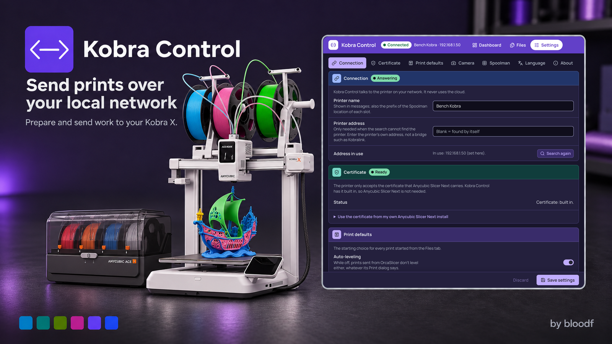
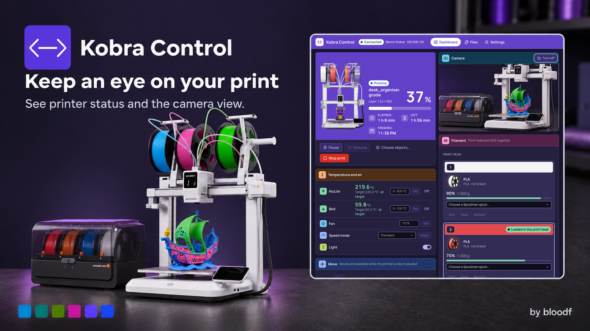
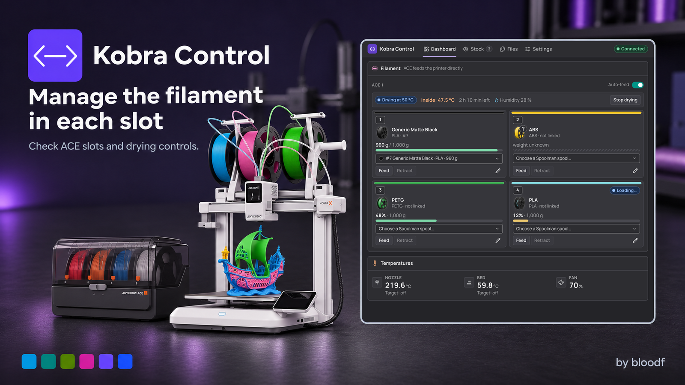
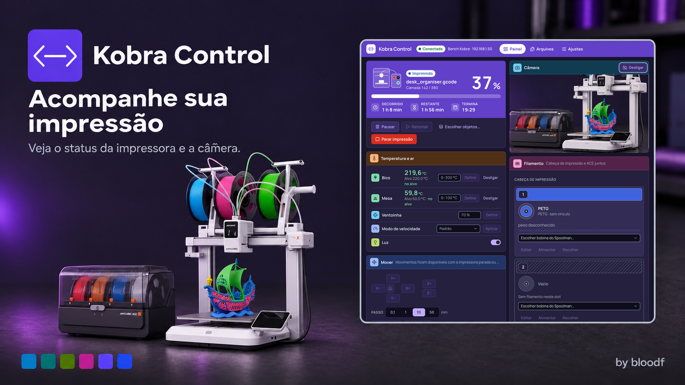
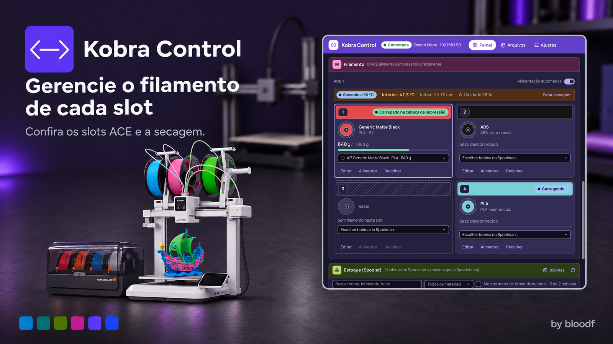
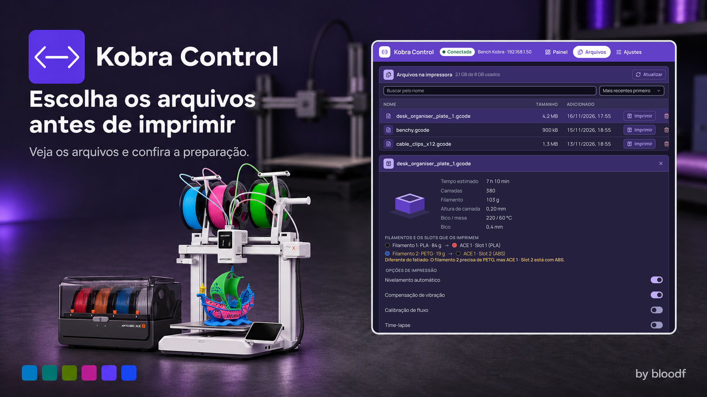

# Orca Cloud description

The listing text for <https://cloud.orcaslicer.com/p/59c786285255>: paste the English block into the English description and the Portuguese block into the Portuguese one. Each block stays under 4000 characters. The four pictures are read from `main` on `raw.githubusercontent.com`, so they show once the commit that adds them is merged. Which image goes in which listing slot is in [release.md](release.md). Keep the plugin list in step with the README's "More plugins by bloodf".

## English

```markdown
Run your Anycubic printer from OrcaSlicer: over your LAN, or through Anycubic Cloud if you opt in.

## Printers

- Kobra X: tested (firmware 2.0.2.8).
- Kobra 3, 3 V2, 3 Max, S1, S1 Max, 4: same LAN protocol, experimental. Testers welcome.
- Kobra 2 Pro, Plus, Max: Anycubic Cloud only, experimental.

An unknown model connects read-only. Needs OrcaSlicer 2.5.0 or newer; no Anycubic Slicer Next needed.

## What it does



Print and Send from OrcaSlicer's own dialogs, with your filament-to-slot mapping.



Status, temperatures, pause, resume, stop, light, fan, speed and camera.



ACE slots with feed, retract and drying, each linked to a Spoolman spool.


The printer's files with time, layers and filament, plus time-lapses.

## How to start

1. Subscribe, open the plugin list (macOS: File > Plugins; Windows/Linux: ▾ next to File > Plugins) and tick Activate on Kobra Control.
2. Turn on LAN mode on the printer. The Kobra Control tab finds it.
3. To print from OrcaSlicer's Print dialog: tick Preferences > Developer > Experimental Features > Use printer agents, restart, set the preset's Printer Agent to `kobracontrol`.

## Privacy

LAN mode talks only to your printer and your Spoolman server. Anycubic Cloud is off until you sign in under Settings; it uses Anycubic's unofficial app interface (see the README for the risk). No telemetry. Use it on a network you trust.

Independent project, not made or supported by Anycubic. English, Português, Español, Deutsch, 简体中文, Polski.

## More plugins by bloodf

[Organizer](https://cloud.orcaslicer.com/p/5bf381fd42d4) · [Embedder](https://cloud.orcaslicer.com/p/58222d4f9e52) · [Print Calculator](https://cloud.orcaslicer.com/p/521c07cf6de2) · [Spooler](https://cloud.orcaslicer.com/p/50c35dcbd6f3) · [U1 Control](https://cloud.orcaslicer.com/p/55b8c347d443)

Source: https://github.com/bloodf/kobracontrol (GPL-3.0-only)
```

## Português (Brasil)

```markdown
Controle sua impressora Anycubic pelo OrcaSlicer: na rede local ou, se você quiser, pela Anycubic Cloud.

## Impressoras

- Kobra X: testada (firmware 2.0.2.8).
- Kobra 3, 3 V2, 3 Max, S1, S1 Max, 4: mesmo protocolo LAN, experimental. Testadores são bem-vindos.
- Kobra 2 Pro, Plus, Max: só pela Anycubic Cloud, experimental.

Um modelo desconhecido conecta só para leitura. Requer OrcaSlicer 2.5.0 ou mais novo; não precisa do Anycubic Slicer Next.

## O que faz


Print e Send pelos diálogos do OrcaSlicer, com o seu mapeamento de filamento para slot.



Status, temperaturas, pausar, retomar, parar, luz, ventoinha, velocidade e câmera.



Slots do ACE com alimentar, recolher e secagem, cada um ligado a uma bobina do Spoolman.



Os arquivos da impressora com tempo, camadas e filamento, e os time-lapses.

## Como começar

1. Assine, abra a lista de plugins (macOS: File > Plugins; Windows/Linux: ▾ ao lado de File > Plugins) e marque Activate no Kobra Control.
2. Ligue o modo LAN na impressora. A aba Kobra Control a encontra.
3. Para imprimir pelo diálogo Print do OrcaSlicer: marque Preferences > Developer > Experimental Features > Use printer agents, reinicie e defina o Printer Agent do perfil como `kobracontrol`.

## Privacidade

No modo LAN, só fala com sua impressora e seu Spoolman. A Anycubic Cloud fica desligada até você entrar em Settings; usa a interface não oficial do app da Anycubic (veja o risco no README). Sem telemetria. Use em uma rede de confiança.

Projeto independente, não é feito nem mantido pela Anycubic. English, Português, Español, Deutsch, 简体中文, Polski.

## Mais plugins do bloodf

[Organizer](https://cloud.orcaslicer.com/p/5bf381fd42d4) · [Embedder](https://cloud.orcaslicer.com/p/58222d4f9e52) · [Print Calculator](https://cloud.orcaslicer.com/p/521c07cf6de2) · [Spooler](https://cloud.orcaslicer.com/p/50c35dcbd6f3) · [U1 Control](https://cloud.orcaslicer.com/p/55b8c347d443)

Código-fonte: https://github.com/bloodf/kobracontrol (GPL-3.0-only)
```
