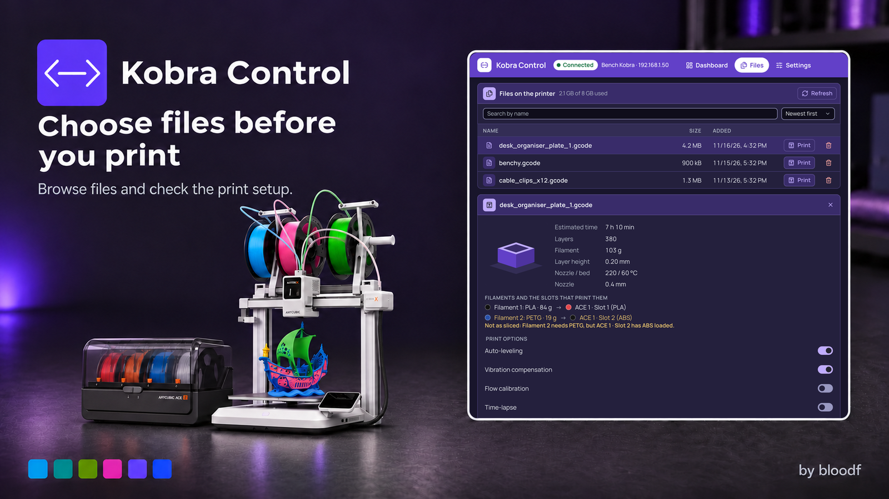

# Orca Cloud description

The listing text for <https://cloud.orcaslicer.com/p/59c786285255>, in English only: paste the block into the listing's description. It stays well under 4000 characters and links to the README for everything else. The four pictures are read from `main` on `raw.githubusercontent.com`, so they show once the commit that adds them is merged. Which image goes in which listing slot is in [release.md](release.md). Keep the plugin list in step with the README's "More plugins by bloodf".

```markdown
Run your Anycubic printer from OrcaSlicer: over your LAN, or through Anycubic Cloud if you opt in.

Full description: https://github.com/bloodf/kobracontrol/blob/main/README.md

## Printers

- Kobra X: tested (firmware 2.0.2.8).
- Kobra 3, 3 V2, 3 Max, S1, S1 Max, 4: same LAN protocol, experimental. Testers welcome.
- Kobra 2 Pro, Plus, Max: Anycubic Cloud only (opt-in), experimental.

An unknown model connects read-only. Needs OrcaSlicer 2.5.0 or newer; no Anycubic Slicer Next needed.

## What it does


Print and Send from OrcaSlicer's own dialogs, with your filament-to-slot mapping. The tab finds the printer by itself; the certificate is built in.


A Dashboard you can rearrange: status, temperatures, pause, resume, stop, light, fan, speed, moves and camera. Most of it also works in OrcaSlicer's Device tab. Alerts take one line and close with one click; they come back only for a new problem.


ACE slots with feed, retract and drying, each linked to a Spoolman spool. Each slot shows the OrcaSlicer preset it reports, and you can pick another. Open Filament Database presets are opt-in.



The printer's files with time, layers and filament, a warning when a slot holds another material, plus time-lapses.

## How to start

1. Subscribe, open the plugin list (macOS: File > Plugins; Windows/Linux: ▾ next to File > Plugins) and tick Activate on Kobra Control.
2. Turn on LAN mode on the printer. The Kobra Control tab finds it.
3. To print from OrcaSlicer's Print dialog: tick Preferences > Developer > Experimental Features > Use printer agents, restart, set the preset's Printer Agent to `kobracontrol`.
4. Something not working? Settings > Requirements > Check everything tests the printer, its login, Spoolman, Anycubic Cloud and OrcaSlicer's permissions in one go, with Allow for a missing permission.

## Privacy

LAN mode talks only to your printer and your Spoolman server. Anycubic Cloud is off until you sign in under Settings; it uses Anycubic's unofficial app interface (see the README for the risk). No telemetry. Use it on a network you trust.

Independent project, not made or supported by Anycubic. English, Português, Español, Deutsch, 简体中文, Polski.

## More plugins by bloodf

[Organizer](https://cloud.orcaslicer.com/p/5bf381fd42d4) · [Embedder](https://cloud.orcaslicer.com/p/58222d4f9e52) · [Print Calculator](https://cloud.orcaslicer.com/p/521c07cf6de2) · [Spooler](https://cloud.orcaslicer.com/p/50c35dcbd6f3) · [U1 Control](https://cloud.orcaslicer.com/p/55b8c347d443)

Source: https://github.com/bloodf/kobracontrol (GPL-3.0-only)
```
